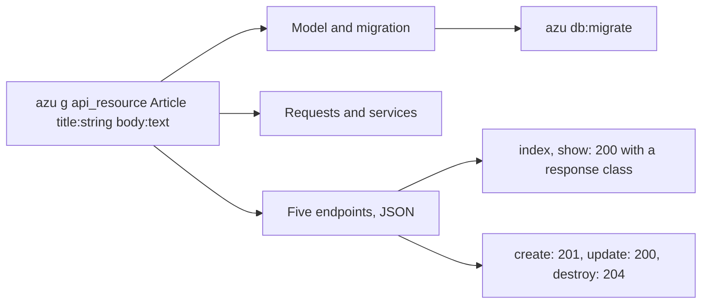

# API resource

`azu g api_resource` writes a JSON API for one resource: five endpoints (index, show, create, update, destroy), request contracts, services, response classes, a model and its migration. It writes no pages, templates, `new` or `edit` routes, in a web project or an API project. It is the [scaffold](scaffold.md) with the API layout forced on, so `azu g scaffold post ... --api-only` writes the same files.

## Overview & visual demo

Generate an API resource with explicit request, endpoint, and response boundaries. Review the generated serialization and validation before exposing the resource to clients.

<figure><figcaption><p>After Enter, <code>azu g</code> lists every file it wrote with its line count. <code>azu undo</code> reverts them.</p></figcaption></figure>



## Quickstart & command syntax

```bash
azu g api_resource Article title:string body:text
azu db:migrate
azu serve
```



```bash
azu g api_resource Article title:string body:text published:bool
```

Every `name:type` becomes a column, a request field and a field of the responses.



```bash
azu g api_resource Article title:string body:text --skip migration
```

Writes the endpoints and models over a table you already have, with no new migration.



```bash
azu g api_resource Article title:string --dry-run   # list the files, write nothing
azu g api_resource Article title:string --check     # type-check with the new files first
```



| Argument or option | Meaning | Default |
| --- | --- | --- |
| `name` | The resource. Singular or plural. Same naming rules as the scaffold | required |
| `name:type[:modifier]` | Columns, request fields and response fields. Types and modifiers as in the [scaffold](scaffold.md) | none |
| `--skip LIST` | Leave out the listed components, as for the scaffold | none |
| `--force` | Overwrite existing files | off |
| `--dry-run` | List the files and changes, write nothing | off |
| `--check` | Type-check the project with the new files before writing | off |
| `--yes` | Write without asking (a terminal still shows the preview) | off |
| `--ui MODE` | `rich` or `plain` | `rich` on a terminal |

The routes it writes:

| Method and path | Endpoint | Answers |
| --- | --- | --- |
| `GET /articles` | `Articles::IndexEndpoint` | `200`, an array of records as JSON |
| `GET /articles/:id` | `Articles::ShowEndpoint` | `200`, one record, or `404` |
| `POST /articles` | `Articles::CreateEndpoint` | `201`, the new record |
| `PATCH /articles/:id` | `Articles::UpdateEndpoint` | `200`, the updated record |
| `DELETE /articles/:id` | `Articles::DestroyEndpoint` | `204` |

## Realistic output


```text
src/db/migrations/<version>_create_articles.cr
src/db/schema.cr                        changed: adds the articles table
src/models/article.cr
src/endpoints/articles/                 create, destroy, index, show, update  _endpoint.cr
src/requests/articles/                  create, destroy, index, show, update  _request.cr
src/requests/predicates.cr
src/services/articles/                  create, destroy, update  _service.cr
src/responses/articles/                 index_response.cr, show_response.cr
```


*Five endpoints, two responses and no pages: the difference from the web scaffold.*


```crystal
require "cql"

class Article
  include CQL::ActiveRecord::Model(Int64)
  db_context BlogDB, :articles

  property title : String
  property body : String
  property created_at : Time?
  property updated_at : Time?

  def initialize(@title : String, @body : String)
  end
end
```


*The model, as for any scaffolded resource.*


```crystal
require "json"

module Blog
  struct Articles::ShowResponse
    include Azu::Response::Negotiable
    include JSON::Serializable

    getter id : Int64?
    getter title : String
    getter body : String

    def initialize(record : Article)
      @id = record.id
      @title = record.title
      @body = record.body
    end

    def render_json : String
      to_json
    end
  end
end
```


*The response lists every column the resource has. `index_response.cr` wraps an array of these.*


```crystal
module Blog
  struct Articles::CreateEndpoint
    include Azu::Endpoint(Articles::CreateRequest, Articles::ShowResponse)

    post "/articles"

    def call : Articles::ShowResponse
      record = Articles::CreateService.new.call(create_request)
      status 201
      Articles::ShowResponse.new(record)
    end
  end
end
```


*A create answers `201` with the record. The request is validated before the endpoint runs.*


```crystal
module Blog
  struct Articles::CreateRequest
    include Azu::Request

    getter title : String
    getter body : String

    validate title, presence: true
    validate body, presence: true
  end
end
```


*A bad request is answered before it reaches the service.*

<details>

<summary>The index endpoint and the migration</summary>


```crystal
module Blog
  struct Articles::IndexEndpoint
    include Azu::Endpoint(Articles::IndexRequest, Articles::IndexResponse)

    get "/articles"

    def call : Articles::IndexResponse
      Articles::IndexResponse.new(Article.all.to_a)
    end
  end
end
```


*The index endpoint loads every record and answers with the index response.*


```crystal
require "cql"

# Migration to create articles table
# Generated at 2026-10-27 21:00:11 UTC
class CreateArticles < CQL::Migration(20261027210011_i64)
  def up
    schema.table :articles do
      primary :id, Int64, auto_increment: true
      text :title
      text :body
      timestamps
    end
    schema.articles.create!
  end

  def down
    # Drop articles table
    schema.articles.drop!
  end
end
```


*The migration for the table. The same table block goes into `src/db/schema.cr`.*

</details>

## Do's and don'ts


Use `--skip migration` when the table is already in your database and you only want the endpoints. Pass the same `name:type` attributes as the table's columns, so the model, requests and responses match it.



**Pro tip:** check the JSON before you ship. Run `azu g api_resource ... --dry-run` to see the file list, then `azu routes` once the app builds to list the five routes.



The generated endpoints are open. Nothing checks who calls them. `azu g auth` is for web projects and refuses API projects, so add your own check before you deploy.



A response lists every column of the resource. Add a sensitive column, such as a password digest, and it goes out in every response. Leave such a column out of the resource, or edit the response class.



`--force` overwrites the endpoints, services and responses you have edited. Generate once, then edit the files you own.


<details>

<summary>OpenAPI</summary>

The app can export an OpenAPI description of its routes. See [OpenAPI commands](../command-reference/azu-openapi.md) for `azu openapi:export`.

</details>
