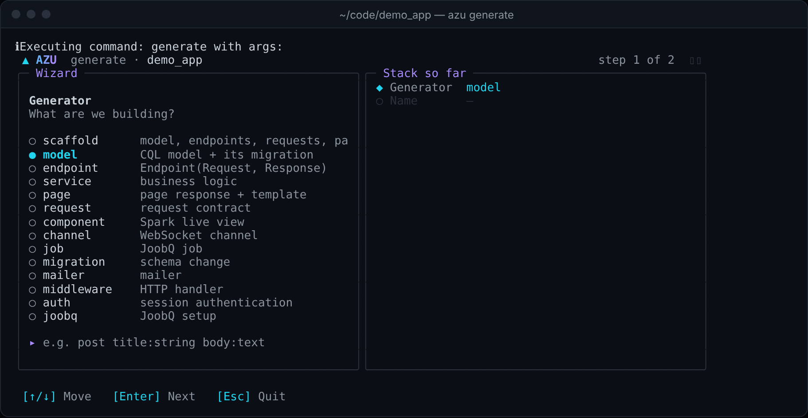
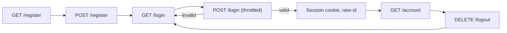

# Authentication

`azu g auth` writes a complete session-cookie login for a web project: a `User` model and its migration, registration, sign in, sign out and an `/account` page that needs a signed-in user. Passwords are bcrypt digests and the session is an encrypted cookie, so there is no extra service to run. Sign-in and sign-up are throttled by code the generator writes. API projects are refused.

## Overview & visual demo

<figure><figcaption><p><code>azu g</code> lists <code>auth</code> as session authentication. The command takes no name.</p></figcaption></figure>



## Quickstart & command syntax

```bash
azu g auth
azu db:migrate
azu serve
```



```bash
azu g auth
```

Takes no name. It writes the files listed below and wires the session handler into the app file.



```bash
azu g auth      # refused: the files it would write already exist
```

It refuses to run when a `User` model, `src/initializers/session.cr`, the auth endpoints or a `create_users` migration already exist (a scaffold named `User` counts). Remove those, or add the handler by hand.



| Option | Meaning | Default |
| --- | --- | --- |
| `--strategy session` | The only accepted strategy. Any other value is refused | `session` |
| `--dry-run` | List the files, write nothing | off |
| `--yes` | Write without asking (a terminal still shows the preview) | off |

Once it has run, the routes are:

| Route | Endpoint | Note |
| --- | --- | --- |
| `GET /register` | `Registrations::NewEndpoint` | sign-up form |
| `POST /register` | `Registrations::CreateEndpoint` | throttled, `303` back to `/login` |
| `GET /login` | `Sessions::NewEndpoint` | sign-in form |
| `POST /login` | `Sessions::CreateEndpoint` | throttled, `303` to `/account` |
| `DELETE /logout` | `Sessions::DestroyEndpoint` | clears the session |
| `GET /account` | `Account::ShowEndpoint` | signed out: `303` to `/login` |

The endpoints live in your app's module, so `Blog::Sessions::CreateEndpoint` in an app called `blog`.

## Realistic output


```text
.env                                  changed: SESSION_SECRET line added (git-ignored)
src/blog.cr                           changed: session handler added after RequestId
src/db/migrations/<version>_create_users.cr
src/db/schema.cr                      changed: adds the users table
src/endpoints/account/                show_endpoint.cr
src/endpoints/registrations/          new_endpoint.cr, create_endpoint.cr
src/endpoints/sessions/               new_endpoint.cr, create_endpoint.cr, destroy_endpoint.cr
src/initializers/session.cr
src/middleware/authentication.cr
src/models/user.cr
src/pages/account/, registrations/, sessions/
src/requests/account/, registrations/, sessions/, bytesize_predicate.cr
src/services/auth_throttle.cr
spec/services/auth_throttle_spec.cr
public/templates/blog/account/, registrations/, sessions/   (.jinja)
```


*The layout of a generated login. The file names follow the same `Blog::<Plural>::<Action><Layer>` scheme as the scaffold.*


```crystal
require "cql"

class User
  include CQL::ActiveRecord::Model(Int64)
  db_context BlogDB, :users

  property email : String
  property password_digest : String
  property created_at : Time?
  property updated_at : Time?

  def initialize(@email : String, @password_digest : String)
  end
end
```


*The user has an email and a bcrypt digest. There is no password column.*


```crystal
require "cql"

# Migration to create users table
# Generated at 2026-10-27 21:00:12 UTC
class CreateUsers < CQL::Migration(20261027210012_i64)
  def up
    schema.table :users do
      primary :id, Int64, auto_increment: true
      text :email, unique: true
      text :password_digest
      timestamps
    end
    schema.users.create!
  end

  def down
    # Drop users table
    schema.users.drop!
  end
end
```


*The email is unique. The table is also appended to `src/db/schema.cr`.*


```crystal
# Written by `azu generate auth`: `azu session:setup` leaves this file alone.
require "session"

# The session lives in an encrypted cookie, so it works behind any number of processes.
class UserSession < Session::Base
  property user_id : Int64? = nil

  def authenticated? : Bool
    !user_id.nil?
  end
end

Session.use_store(Session::CookieStore(UserSession))

Session.configure do |config|
  # SESSION_SECRET comes from the environment or the git-ignored .env. Development falls back to a random key
  # per process, which signs users out on every restart; production refuses to boot without it.
  config.secret = Azu::Env.secret("SESSION_SECRET")
  config.session_key = "blog_session"

  # The session shard sets the cookie flags itself: Secure, HttpOnly, SameSite=Strict (browsers keep a
  # Secure cookie over plain http only on localhost). It expires with the session timeout.
  # The cookie store keeps the session in the browser: signing out clears that cookie, but a copy of
  # it stays valid until it expires. Shorten the timeout, or switch to Session::RedisStore, if you
  # need server-side revocation.
  config.timeout = 8.hours
  config.store = Session::CookieStore(UserSession).new
end
```


*The cookie store and its settings. The secret is read from the environment or `.env`, never written here.*


```crystal
module Blog
  struct Sessions::CreateEndpoint
    include Azu::Endpoint(Sessions::CreateRequest, Azu::Response::Empty)
    include Authentication

    post "/login"

    def call : Azu::Response::Empty
      email = create_request.email.strip.downcase
      throttle_login!(email)
      unless user = authenticate(email, create_request.password)
        Session.session.flash["error"] = "Invalid email or password"
        return redirect to: "/login", status: 303
      end

      Session.session.current_session.user_id = user.id
      Session.session.regenerate_id # a new session id, so a planted one is worthless (session fixation)
      redirect to: "/account", status: 303
    end
  end
end
```


*Sign in throttles first, then checks the password. A wrong email and a wrong password get the same answer.*

<details>

<summary>Throttling: limits and settings</summary>

Sign-in and sign-up count attempts in `Blog::AuthThrottle` (`src/services/auth_throttle.cr`): a fixed window per key, kept in memory. An attempt over the limit answers `429` with a `Retry-After` header and is not processed.

| Environment variable | Default | Counts |
| --- | --- | --- |
| `AUTH_THROTTLE_LOGIN` | 5 | sign-in per client address and email |
| `AUTH_THROTTLE_ADDRESS` | 20 | sign-in per client address, any email |
| `AUTH_THROTTLE_REGISTER` | 5 | sign-up per client address |
| `AUTH_THROTTLE_WINDOW` | 60 | seconds in a window |
| `AUTH_THROTTLE_TRUST_PROXY` | unset | `true` takes the client address from the last `X-Forwarded-For` entry |

- There is no counter per email alone. Otherwise anyone could lock a known account out by failing from their own address.
- Behind a reverse proxy every client shares the sign-up limit unless `AUTH_THROTTLE_TRUST_PROXY=true`. Set it only when exactly one proxy you run sits in front of the app.
- Counters are per process and reset on restart.

</details>

<details>

<summary>Passwords, sessions and what is not generated</summary>

- Sign-up accepts 8 to 72 characters and at most 72 bytes. Sign-in rejects more than 72 bytes. bcrypt reads no more than 72.
- Signing in gives the session a new id. Signing out discards it.
- The email is stripped and downcased. An unknown email costs the same bcrypt check as a wrong password.
- `SESSION_SECRET` is generated into the git-ignored `.env`. Production refuses to boot without it.
- Not generated: JWT or OAuth, roles and permissions, password reset, email confirmation.

</details>

## Do's and don'ts


Run `azu db:migrate` and then `azu serve` straight after generating. The `SESSION_SECRET` is already in `.env`, so the app boots without more setup.



**Pro tip:** protect another page by including `Authentication` in its endpoint and calling `current_user`. Copy the `/account` endpoint's guard.



The cookie store keeps the session in the browser. Signing out clears that cookie, but a copy taken earlier stays valid until the 8-hour timeout. For server-side revocation, shorten the timeout or move to `Session::RedisStore`.



The throttle counts live in the process. Several processes each allow the limit, and a restart forgets the counts. Share a store if that matters for your deployment.



Don't commit `.env`, and don't put `SESSION_SECRET` in code. Set it in your host's environment for production. A leaked secret lets anyone forge a session.

