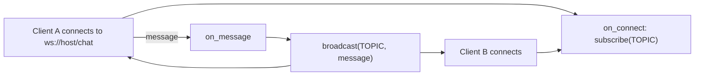

# Channel

`azu g channel` writes one `Azu::Channel` class under `src/channels/`, served at a WebSocket path named after the channel. Every message a client sends goes to every client of the channel, the sender included. The project loads `src/channels/**` at boot. Change `on_connect` and `on_message` to add rooms, authentication or filtering.

## Overview & visual demo

<figure><figcaption><p><code>azu g</code> lists <code>channel</code> as a WebSocket channel. The command takes a name and nothing else.</p></figcaption></figure>



## Quickstart & command syntax

```bash
azu g channel Chat
azu g channel ChatRoom --dry-run
```



```bash
azu g channel Chat        # src/channels/chat_channel.cr, served at /chat
```



```bash
azu g channel ChatRoom    # src/channels/chat_room_channel.cr, served at /chat_room
```



```bash
azu g channel Chat --dry-run   # list the file, write nothing
```



| Argument or option | Meaning | Default |
| --- | --- | --- |
| `name` | Letters, digits and underscores, starting with a letter. The class gets a `Channel` suffix | required |
| `--force` | Overwrite the file if it exists | off |
| `--dry-run` | List the file, write nothing | off |
| `--yes` | Write without asking (a terminal still shows the preview) | off |

A channel takes no actions. `azu g channel Chat send` is refused, because the channel relays every message to all of its clients.

## Realistic output


```crystal
module Blog
  # Every message a client sends reaches all the clients of the channel, the sender included.
  # Clients connect to ws://<host>/chat.
  #
  # Azu checks the Origin of every connection against `Azu::CONFIG.websocket.allowed_origins`
  # (WEBSOCKET_ALLOWED_ORIGINS; the page's own host is always allowed) and closes connections whose
  # messages exceed `websocket.max_message_size` (WEBSOCKET_MAX_MESSAGE_SIZE, 1 MiB).
  # Messages are relayed as they come: clients must show them as text, never as innerHTML.
  class ChatChannel < Azu::Channel
    TOPIC = "chat"

    ws "/chat"

    def on_connect
      subscribe(TOPIC)
    end

    def on_message(message : String)
      broadcast(TOPIC, message)
    end

    def on_binary(binary : Bytes)
    end

    def on_ping(message : String)
    end

    def on_pong(message : String)
    end

    def on_close(code : HTTP::WebSocket::CloseCode?, message : String?)
    end
  end
end
```


*The generated channel for `azu g channel Chat` in a project whose module is `Blog`. The header comment is the template's, and it describes the limits the app applies.*

## Do's and don'ts


Check who is connecting in `on_connect` before you `subscribe`. The generated channel accepts every connection that passes the origin check, so a room or a private topic needs its own check.



**Pro tip:** use the `TOPIC` constant for a room name. Change it per room, or derive it from the connection, and every `broadcast` goes only to that topic's subscribers.



Messages are relayed as they arrive. Clients must show them as text. Rendering a message as HTML is a cross-site scripting hole.



Origins are checked against `WEBSOCKET_ALLOWED_ORIGINS`, and messages above `WEBSOCKET_MAX_MESSAGE_SIZE` (1 MiB by default) close the connection. Set both for your deployment; the page's own host is always allowed.



`on_message` broadcasts whatever it gets. Add validation before the `broadcast` call: a message that is not valid for your app should never reach the other clients.


<details>

<summary>Related generators</summary>

- [Request](request.md) validates input in the HTTP layer. A channel has no request class, so validate inside `on_message`.
- [Custom validator](custom-validator.md) is a reusable place for the checks.
- The command's full reference is [azu generate](../command-reference/azu-generate.md).

</details>
