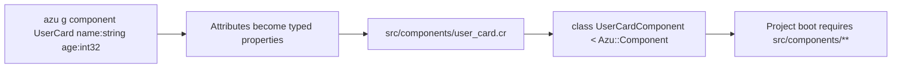

# Component

`azu g component` writes one `Azu::Component` class under `src/components/`. Each `name:type` attribute becomes a typed property, with a default for the types that have one, and the class comes with a placeholder `content` method to replace. The project loads `src/components/**` at boot, so a new component is available to the app without a require.

## Overview & visual demo

<figure><figcaption><p>After Enter, <code>azu g</code> lists each file it wrote with its line count. <code>azu undo</code> reverts them.</p></figcaption></figure>



## Quickstart & command syntax

```bash
azu g component UserCard name:string age:int32 active:bool
azu g component UserCard name:string --dry-run
```



```bash
azu g component UserCard name:string age:int32 active:bool tags:array
```

Each attribute is `name:type`. Unknown types become `String`. The types and defaults are in the table below.



```bash
azu g component UserCard name:string --dry-run   # list the file, write nothing
```



| Argument or option | Meaning | Default |
| --- | --- | --- |
| `name` | PascalCase. The class gets a `Component` suffix; the file is the underscored name | required |
| `name:type` | A property and a constructor argument | none |
| `--force` | Overwrite the file if it exists | off |
| `--dry-run` | List the file, write nothing | off |
| `--yes` | Write without asking (a terminal still shows the preview) | off |

| Type | Crystal type | Default |
| --- | --- | --- |
| `string`, `text` | `String` | none |
| `int32`, `integer` | `Int32` | `0` |
| `int64` | `Int64` | none |
| `float32` | `Float32` | none |
| `float64`, `float` | `Float64` | none |
| `bool`, `boolean` | `Bool` | `false` |
| `time`, `datetime` | `Time` | none |
| `date` | `Date` | none |
| `array` | `Array(String)` | `[] of String` |
| `hash` | `Hash(String, String)` | `{} of String => String` |
| `json` | `JSON::Any` | none |
| anything else | `String` | none |

## Realistic output


```text
src/components/user_card.cr
```


*One file: the component class.*


```crystal
class UserCardComponent
  include Azu::Component


  property name : String
  property age : Int32 = 0
  property active : Bool = false
  property tags : Array(String) = [] of String


  def initialize(@name : String, @age : Int32, @active : Bool, @tags : Array(String))
  end

  def content
    div(class: "bg-white p-4 rounded-lg shadow-md") do
      h3(class: "text-lg font-semibold mb-2") { text "UserCardComponent" }
      div(class: "p-4") do
        text "Component content goes here"
      end
    end
  end


end
```


*The blank lines are the template's. The placeholder `content` is the part you replace.*

## Do's and don'ts


Keep a component to the data it shows. Pass each value through the constructor, and give the optional ones a default, as the generator does for `int32`, `bool`, `array` and `hash`.



**Pro tip:** name the component for what it shows, not where it lives. `UserCard` is a good name; `Page2Sidebar` is not.



Types the generator does not know become `String` without a message. `score:decimal` is a `String`. Check the table above before you rely on a type.



The `content` method and the `UserCardComponent` text are placeholders. Replace them before the component goes anywhere a user sees it.



`--force` overwrites `src/components/user_card.cr`. Edit the file after generating; don't regenerate it over your changes.


<details>

<summary>Related generators</summary>

- [Page](page.md) is the server-rendered layer the components sit beside.
- [Custom validator](custom-validator.md) follows the same skeleton pattern for validation logic.
- The command's full reference is [azu generate](../command-reference/azu-generate.md).

</details>
