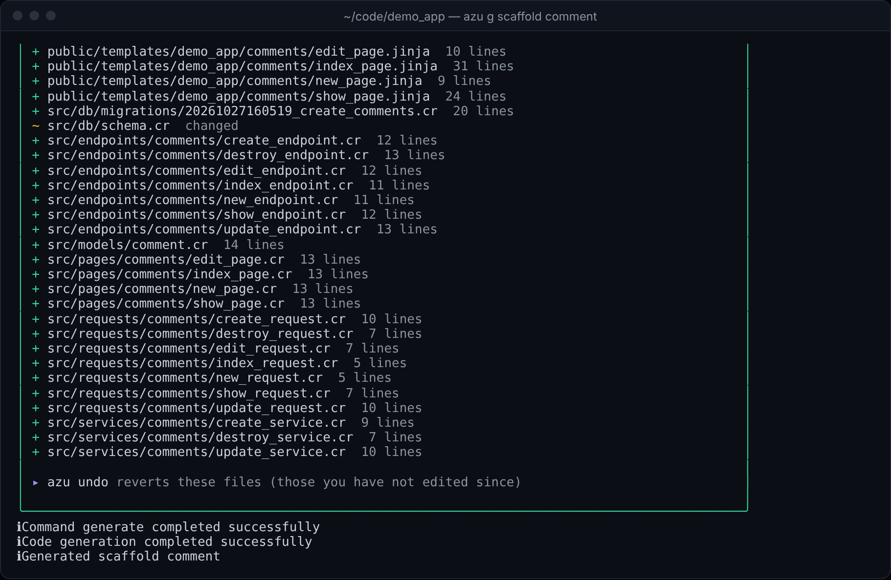
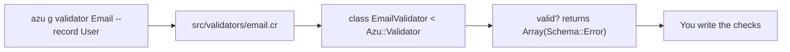

# Custom validator

`azu g validator` writes one `Azu::Validator` class for a record type. Its `valid?` method returns an empty error list, and the file carries a comment block of the usual checks to copy from. The command takes no rule options, so the checks are yours to write.

## Overview & visual demo

<figure><figcaption><p>After Enter, <code>azu g</code> lists the file it wrote and its line count.</p></figcaption></figure>



## Quickstart & command syntax

```bash
azu g validator Email --record User
azu g validator Email --record Post --dry-run
```



```bash
azu g validator Email --record User
```

`--record` names the type the validator checks. It defaults to `User` and is written into the constructor (`@record : User`).



```bash
azu g validator Email --record Post --dry-run   # list the file, write nothing
```



| Argument or option | Meaning | Default |
| --- | --- | --- |
| `name` | The validator's name, without the suffix. `Email` gives `EmailValidator` in `email.cr` | required |
| `--record TYPE` | The record type the validator takes | `User` |
| `--force` | Overwrite the file if it exists | off |
| `--dry-run` | List the file, write nothing | off |
| `--yes` | Write without asking (a terminal still shows the preview) | off |

## Realistic output


```crystal
class EmailValidator < Azu::Validator
  getter :record

  def initialize(@record : User)
  end

  def valid? : Array(Schema::Error)
    errors = [] of Schema::Error

    # Custom logic here

    errors
  end


# Common validation patterns:
#
# Presence validation:
# if @record.field?.try(&.empty?)
#   errors << Schema::Error.new("field", "Field is required")
# end
#
# Format validation:
# if @record.email? && !@record.email!.match(/^[\w\-\.]+@[\w\-\.]+\.[a-zA-Z]{2,}$/)
#   errors << Schema::Error.new("email", "Invalid email format")
# end
#
# Length validation:
# if @record.name? && @record.name!.size < 2
#   errors << Schema::Error.new("name", "Name must be at least 2 characters")
# end
#
# Uniqueness validation:
# if User.where(field: @record.field).exists?
#   errors << Schema::Error.new("field", "Field must be unique")
# end
#
# Range validation:
# if @record.age? && (@record.age! < 0 || @record.age! > 150)
#   errors << Schema::Error.new("age", "Age must be between 0 and 150")
# end

end
```


*The file as `azu g validator Email --record User` renders it. The comment block is the template's, with `User` filled in for the uniqueness example.*

The check bodies in the generator (`email`, `presence`, `length`, `uniqueness`, `format`, `range`) are not reachable from the command. They only apply when rules are passed to the generator class, so write the checks in `valid?` yourself.

## Do's and don'ts


Write one check per `if` and add one `Schema::Error` per problem, with the field name the form uses. The error list is what the caller reads, so a message that names the field is the one that helps.



**Pro tip:** pass `--record` the model you will validate. The constructor then types `@record` as that model, so the checks you write against it compile against the right type.



Pass the name without the suffix. `azu g validator EmailValidator` writes `class EmailValidatorValidator` in `email_validator.cr`. Use `Email`.



The uniqueness pattern in the comment is a query, so two requests can both pass it at once. For a hard guarantee, declare the column `unique` (`email:string:unique` on the [scaffold](scaffold.md)) so the database refuses the second row.



`--force` overwrites a validator you have already filled in. Generate once, then edit the file.


<details>

<summary>Related generators</summary>

- [Request](request.md) is where the framework validates input (`validate email, presence: true`). Start there when the rule is about a single request.
- [Component](component.md) uses the same class-per-file skeleton for view code.
- The command's full reference is [azu generate](../command-reference/azu-generate.md).

</details>
