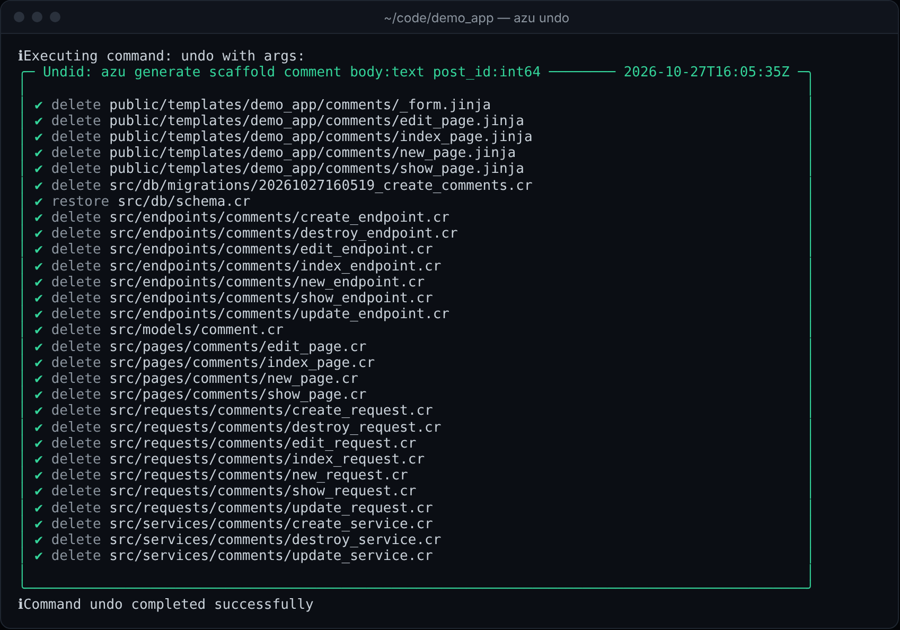
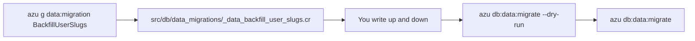

# Data migration

`azu g data:migration` writes one `CQL::Migration` class under `src/db/data_migrations/`. Its `up` and `down` change records: backfill a column, move rows between tables, normalize values. It does not change the schema. Schema migrations and data migrations share one version sequence, so their timestamps never repeat, and you run the data ones with `azu db:data:migrate`.

## Overview & visual demo

Generate a data migration for a deliberate, reviewable transformation of stored records. Keep its operational cost and rollback behavior explicit before applying it to shared data.

<figure><figcaption><p>A data migration is one new file. <code>azu undo</code> removes it again, as long as you have not edited it since.</p></figcaption></figure>



## Quickstart & command syntax

```bash
azu g data:migration BackfillUserSlugs
azu db:data:migrate --dry-run
azu db:data:migrate
```



```bash
azu g data:migration BackfillUserSlugs     # class BackfillUserSlugs
azu g data_migration BackfillUserSlugs     # the same, underscored spelling
```

The name becomes the class in PascalCase. The file name is the underscored name, prefixed with `data_`.



```bash
azu db:data:migrate --dry-run      # list what would run, change nothing
azu db:data:migrate                # run the pending data migrations
azu db:data:migrate --steps 1      # run at most one
```



| Argument or option | Meaning | Default |
| --- | --- | --- |
| `name` | The migration's name. It becomes the class (`BackfillUserSlugs`) and the file name | required |
| `--force` | Overwrite the file if it exists | off |
| `--dry-run` | List the file, write nothing | off |
| `--yes` | Write without asking (a terminal still shows the preview) | off |

The generator takes no attributes. Write the record changes yourself.

## Realistic output


```crystal
# Data migration: BackfillUserSlugs
# This file contains data transformation logic
# Run with: azu db:data:migrate
#
# Examples:
#
#   # Update existing records
#   User.where(role: nil).update_all(role: "user")
#
#   # Migrate data with batch processing
#   User.where(active: true).find_in_batches(batch_size: 1000) do |users|
#     users.each do |user|
#       user.full_name = "#{user.first_name} #{user.last_name}"
#       user.save!
#     end
#   end

require "../../models/**"

class BackfillUserSlugs < CQL::Migration(20261027210011_i64)
  def up
    # Transform data here
    # Example: Update existing records
    puts "Running data migration: BackfillUserSlugs"
    
    # TODO: Add your data transformation logic here
    # Example:
    # User.where(role: nil).update_all(role: "user")
    # puts "Updated #{User.where(role: "user").count} users with default role"
    
    puts "✓ Data migration completed: BackfillUserSlugs"
  end

  def down
    # Rollback data changes here
    puts "Rolling back data migration: BackfillUserSlugs"
    
    # TODO: Add your rollback logic here
    # Example:
    # User.where(role: "user").update_all(role: nil)
    # puts "Rolled back user roles"
    
    puts "✓ Data migration rollback completed: BackfillUserSlugs"
  end
end
```


*The file as generated: the header and the two stubs are all there is. The `up` and `down` bodies are yours.*

## Do's and don'ts


Write `up` so that running it twice changes nothing. Select the rows that still need the change (`where(slug: nil)`), not every row, so a retry after a failure picks up where it stopped.



**Pro tip:** run `azu db:data:migrate --dry-run` before every real run. It lists what would run and changes no data.



The generated `down` is a `puts` and a TODO. Until you write it, rolling the migration back changes no data and only prints.



The file requires `../../models/**`, so every model must compile for the migration to run. A model you change later can break an old data migration. Where a migration needs a model's exact shape, write the query it needs inside the migration instead of depending on the model.



Don't change the schema here. Adding a column or a table belongs in a [migration](migration.md), which `db:migrate` runs.


<details>

<summary>Versions</summary>

Data and schema migrations share one version sequence: the generator takes the timestamp of the newest migration of either kind, or the second after it, so a version is never reused. The rule is the same as for [schema migrations](migration.md).

</details>

<details>

<summary>Related</summary>

- [Migration](migration.md) for schema changes, and [database commands](../command-reference/azu-db.md) for `db:data:migrate` options.
- [azu undo](../command-reference/azu-generate.md) removes a generated file you have not edited since.

</details>
