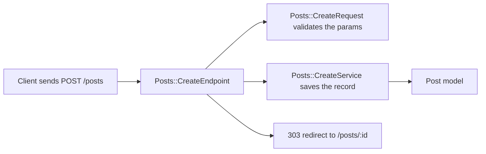

# Endpoint

`azu g endpoint` writes one `Azu::Endpoint` struct per action, under `src/endpoints/<plural>/`. A web endpoint answers reads with a page and writes with a `303` redirect. An API endpoint answers with JSON. The endpoint names its request and its response, but it doesn't create them: generate those with `azu g request` and `azu g page`, or use `azu g scaffold` to make everything at once.

## Overview & visual demo

<figure><figcaption><p><code>azu routes</code> after generating the Posts endpoints. Each row names the endpoint, its request and its response: the three types the generator refers to.</p></figcaption></figure>



## Quickstart & command syntax

```bash
azu g endpoint posts index show create update destroy
azu g endpoint posts index show new edit
azu g endpoint posts index show create --api-only
```



```bash
azu g endpoint posts index show create   # pages for reads, 303 redirects for writes
```



```bash
azu g endpoint posts index show create --api-only   # JSON, 201 on create, 204 on destroy
```



```bash
azu g endpoint posts index show create --dry-run    # list the files and diffs, write nothing
```



| Part            | Meaning                                                                      | Default                                        |
| --------------- | ---------------------------------------------------------------------------- | ---------------------------------------------- |
| `name`          | Singular or plural name: `post` and `posts` both make `Posts::...`           | required                                       |
| `actions`       | Any of `index show new create edit update destroy`, space-separated          | `index show create update destroy`             |
| `--api-only`    | JSON responses instead of pages                                              | on in an API project, off otherwise            |
| `--web-only`    | Forces web endpoints in an API project                                       | off                                            |
| `--force`       | Overwrite existing files without asking                                      | off                                            |
| `--dry-run`     | List files and diffs, write nothing                                          | off                                            |
| `--check`       | Type-check with the new files; write nothing if it doesn't compile           | off                                            |
| `--yes`         | Write without asking (the plan is still printed on a terminal)               | off                                            |

An action outside that list is refused, and the error names the supported ones.

Each action maps to one route. The web response is shown here; in API mode, `create` and `update` answer with `Posts::ShowResponse`, `index` with `Posts::IndexResponse`.

| Action    | Route              | Web response                                      |
| --------- | ------------------ | ------------------------------------------------- |
| `index`   | `GET /posts`       | `Posts::IndexPage`                                |
| `show`    | `GET /posts/:id`   | `Posts::ShowPage`                                 |
| `new`     | `GET /posts/new`   | `Posts::NewPage`                                  |
| `create`  | `POST /posts`      | `Azu::Response::Empty`, `303` to `/posts/:id`     |
| `edit`    | `GET /posts/:id/edit` | `Posts::EditPage`                              |
| `update`  | `PATCH /posts/:id` | `Azu::Response::Empty`, `303` to `/posts/:id`     |
| `destroy` | `DELETE /posts/:id` | `Azu::Response::Empty`, `303` to `/posts`        |

## Realistic output


```text
src/endpoints/posts/index_endpoint.cr
src/endpoints/posts/show_endpoint.cr
src/endpoints/posts/create_endpoint.cr
```


The endpoints of a `blog` project, as the web templates render them:


```crystal
module Blog
  struct Posts::IndexEndpoint
    include Azu::Endpoint(Posts::IndexRequest, Posts::IndexPage)

    get "/posts"

    def call : Posts::IndexPage
      Posts::IndexPage.new(Post.all.to_a)
    end
  end
end
```


*A read returns its page. `Posts::IndexRequest` and `Posts::IndexPage` come from `azu g request` and `azu g page`.*


```crystal
module Blog
  struct Posts::CreateEndpoint
    include Azu::Endpoint(Posts::CreateRequest, Azu::Response::Empty)

    post "/posts"

    def call : Azu::Response::Empty
      record = Posts::CreateService.new.call(create_request)
      redirect to: "/posts/#{record.id}", status: 303
    end
  end
end
```


*A write calls its service and redirects with 303. One endpoint has one response type, so a redirect never returns a page.*

With `--api-only`, the same action answers with JSON:


```crystal
module Blog
  struct Posts::CreateEndpoint
    include Azu::Endpoint(Posts::CreateRequest, Posts::ShowResponse)

    post "/posts"

    def call : Posts::ShowResponse
      record = Posts::CreateService.new.call(create_request)
      status 201
      Posts::ShowResponse.new(record)
    end
  end
end
```


*The API create returns the record with status 201. Destroy returns 204 with an empty response.*

## Do's and don'ts


**Pro tip:** `azu routes` lists every endpoint with its request and response type. Run it after generating to check that the names line up.



Keep writes as `303` redirects in web endpoints. A `POST` that returns a page makes the browser resubmit the form on refresh.



The endpoint doesn't create its request, page or service. Generate them (or use `azu g scaffold`) before you compile. With `--check`, missing types make the command refuse to write.



Don't pass `--force` over an endpoint you have edited. It overwrites the file without asking.

