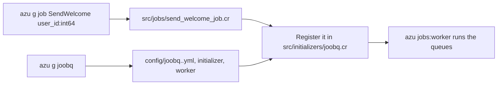

# JoobQ

`azu g joobq` adds JoobQ to a project: three YAML configs (development, production and test), an initializer that reads `REDIS_URL`, an example job and `src/worker.cr`. `azu g job` writes one `JoobQ::Job` struct per job, with typed parameters. A worker started with `azu jobs:worker` runs the queues the initializer registers.

## Overview & visual demo

<figure><figcaption><p><code>azu g</code> lists <code>joobq</code> as JoobQ setup and <code>job</code> as a JoobQ job. <code>joobq</code> takes no name.</p></figcaption></figure>



## Quickstart & command syntax

```bash
azu g joobq
azu g job SendWelcome user_id:int64
azu jobs:worker
```



```bash
azu g joobq      # no name; writes the config, initializer, worker and example job
```

Existing files are kept unless you pass `--force`.



```bash
azu g job SendWelcome user_id:int64
azu g job ProcessPayment user_id:int64 amount:float64
```

The class is `SendWelcomeJob`. The file is `send_welcome_job.cr`.



```bash
REDIS_URL=redis://localhost:6379 azu jobs:worker
```

The initializer reads `REDIS_URL` (default `redis://localhost:6379`). The generator has no `--redis` flag, so set the URL in the environment or in `.env`.



**`azu g joobq`** takes no options beyond the global ones. **`azu g job`** takes these:

| Argument or option | Meaning | Default |
| --- | --- | --- |
| `name` | Letters, digits and underscores, starting with a letter. The class gets a `Job` suffix | required |
| `param:type` | A property and a constructor argument. Known types: `string`, `text`, `int32`, `int64`, `float32`, `float64`, `bool`, `time`, `date`, `array`, `hash`, `json`. Any other type becomes `String`. A trailing `?` makes it nilable | none |
| `--force` | Overwrite the file if it exists | off |

Every generated job uses the queue `default`, three retries and a one-day expiry. The CLI has no option for them, so change the file to set your own.

## Realistic output


```crystal
# JoobQ's Redis store reads REDIS_HOST, REDIS_PORT and REDIS_PASS. REDIS_URL (`azu jobs:worker` sets it) supplies the
# ones that are not set; this runs before JoobQ builds a store, so enqueue, delay and the workers share one Redis.
redis = URI.parse(ENV["REDIS_URL"]? || "redis://localhost:6379")
ENV["REDIS_HOST"] ||= redis.host || "localhost"
redis.port.try { |port| ENV["REDIS_PORT"] ||= port.to_s }
redis.password.try { |password| ENV["REDIS_PASS"] ||= password }

require "joobq"
require "../jobs/**"

# Queues name their job classes (config/joobq.<CRYSTAL_ENV>.yml, or the queue_configs below): register each one.
JoobQ::QueueFactory.register_job_type(ExampleJob)
# JoobQ::QueueFactory.register_job_type(EmailJob)

environment = ENV["CRYSTAL_ENV"]? || "development"
config_file = "config/joobq.#{environment}.yml"

if File.exists?(config_file)
  JoobQ.initialize_config_with(:file, config_file)
else
  Log.warn { "JoobQ config file not found: #{config_file}, using defaults" }

  JoobQ.configure do |config|
    config.default_queue = "default"
    config.retries = 5
    config.timeout = 30.seconds
    config.time_location = "UTC"
    config.worker_batch_size = 50
    config.rest_api_enabled = true
  end
  # JoobQ.forge starts the queues listed in queue_configs
  JoobQ.config.queue_configs["default"] = {job_class_name: "ExampleJob", workers: 3, throttle: nil}
end

# Disable REST API for worker processes
if ARGV.includes?("--worker")
  JoobQ.config.rest_api_enabled = false
  Log.info { "JoobQ REST API disabled for worker process" }
end
```


*The initializer `azu g joobq` writes. It loads the YAML for the environment, or falls back to the inline settings if there is no file.*


```yaml
joobq:
  settings:
    default_queue: "default"
    retries: 5
    timeout: "30 seconds"
    timezone: "UTC"
    worker_batch_size: 50

  # Queue configurations
  # Define job queues with their specific job classes and worker counts
  queues:
    default:
      job_class: "ExampleJob"
      workers: 3

    # Example: Email queue
    # email:
    #   job_class: "EmailJob"
    #   workers: 3

    # Example: Mailer queue
    mailers:
      job_class: "MailerJob"
      workers: 2
```


*The development config. The `mailers` queue names a `MailerJob` the generator does not write: point it at a job you have, or delete it. The production and test files list more sample queues in the same way.*


```crystal
require "./initializers/joobq"
require "./jobs/**"

# JoobQ worker: runs the queues configured in src/initializers/joobq.cr (and config/joobq.<env>.yml).
# Start it with `azu jobs:worker`, or `crystal run src/worker.cr -- --worker`.
# Redis: REDIS_URL, else the URL in src/initializers/joobq.cr

Log.info { "Starting JoobQ workers for queues: #{JoobQ.queues.keys.join(", ")}" }

{Signal::INT, Signal::TERM}.each do |signal|
  signal.trap do
    Log.info { "Stopping JoobQ workers" }
    exit
  end
end

# Starts the queues and blocks
JoobQ.forge
```


*The worker entry point. It is written only when the file does not exist.*

<details>

<summary>A generated job: src/jobs/send_welcome_job.cr</summary>

`azu g job SendWelcome user_id:int64` writes this. The enqueue examples in the header come from the parameters.


```crystal
# SendWelcomeJob - Background Job
# Generated by Azu CLI
#
# This job is configured to:
# - Run in queue: default
# - Retry up to 3 times on failure
# - Expire after 1.days
#
# To enqueue this job:
#   SendWelcomeJob.enqueue(user_id: value)
#
# To run it in 5 minutes:
#   SendWelcomeJob.delay(for: 5.minutes, user_id: value)

struct SendWelcomeJob
  include JoobQ::Job

  # Queue configuration
  @queue   = "default"
  # Number of retries on failure
  @retries = 3
  # A job not run within 1.days expires (JoobQ stores the Unix time in milliseconds)
  @expires = 1.days.from_now.to_unix_ms


  # Job parameters
  property user_id : Int64

  def initialize(@user_id : Int64)
  end


  # Perform the job
  # This method is called when the job is processed
  def perform
    Log.info { "Starting SendWelcome job with parameters" }

    begin
      # Log parameter values for debugging
      Log.info { "Processing user_id: "+@user_id.to_s }

      # Add your job logic here
      # Example:
      # - Process the parameters
      # - Send emails to users
      # - Process data based on parameters
      # - Call external APIs with parameters

      Log.info { "SendWelcome job completed successfully" }
    rescue ex
      Log.error(exception: ex) { "Failed to process SendWelcome job" }
      raise ex # Let JoobQ handle retries
    end
  
  rescue ex : Exception
    # Log the error and re-raise for JoobQ's retry mechanism
    Log.error(exception: ex) { "Failed to process SendWelcomeJob" }
    raise ex
  end
end

# A worker runs it once a queue does; in src/initializers/joobq.cr add
#   JoobQ::QueueFactory.register_job_type(SendWelcomeJob)
#   JoobQ.config.queue_configs["default"] = {job_class_name: "SendWelcomeJob", workers: 2, throttle: nil}
```


*The job as generated: the `perform` body is the stub, and the `rescue` in it re-raises for JoobQ's retry. The stub logs; put the work where the comments say.*

</details>

## Do's and don'ts


Register each job class and give its queue a `queue_configs` entry in `src/initializers/joobq.cr`. The generated job's footer shows the two lines. A job whose class is not registered never runs.



**Pro tip:** pass only what the job needs. Store an id (`user_id:int64`) and load the record inside `perform`, not a whole object.



The `--redis`, `--project`, `--no-example`, `--queue`, `--retries` and `--expires` options in older docs do not exist: the command rejects them with `Invalid option`. Set the Redis URL with `REDIS_URL`.



The YAML files list sample queues (`mailers`; production also has `email` and `critical`) that name job classes the generator does not write. Delete the ones you don't use, or create their classes.



Don't put a Redis password in `src/initializers/joobq.cr`. The file is committed to git. Keep it in `REDIS_URL`, in the environment or in `.env`, and make sure `.env` is git-ignored.


<details>

<summary>Related generators and commands</summary>

- [Mailer](mailer.md) writes a job that sends an email. Register it the same way.
- Worker and queue commands are in [background jobs commands](../command-reference/azu-jobs.md).
- The command's full reference is [azu generate](../command-reference/azu-generate.md).

</details>
