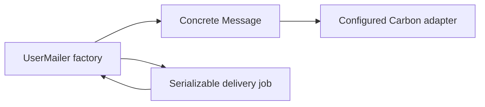

# Mailer

## Overview & visual demo

Generate a Carbon message factory and optional JoobQ delivery job. The factory builds messages, Carbon handles transport, and the optional development hooks expose static previews and delivery outcomes in Mailers.

<figure><figcaption><p>Select mailer or use the command directly.</p></figcaption></figure>



## Quickstart & command syntax

```bash
azu g mailer User welcome password_reset
azu g mailer Receipt receipt --skip job
```

Add the optional dependency, then run `shards install`:

```yaml
dependencies:
  carbon:
    github: luckyframework/carbon
    version: 0.6.1
```

| Argument/flag | Effect |
| --- | --- |
| `<name>` | Domain name such as `User`; the generator appends `Mailer` |
| `[methods]` | One factory method per name; default `welcome` |
| `--skip job` | Generate synchronous delivery only |
| `--dry-run`, `--check`, `--yes`, `--force` | Shared preview, compilation and overwrite controls |

```crystal
message = UserMailer.new.welcome(
  to: Carbon::Address.new("Recipient", "user@example.com"),
  params: {"name" => "Ada"}
)
message.deliver
UserMailer.new.welcome_later(to: Carbon::Address.new("user@example.com"), name: "Ada")
```

Named keyword values are converted to `Hash(String, String)` before enqueueing. The job stores the raw email address, not its formatted display name. It reconstructs the same message factory call with `params: @params`.

### Delivery configuration

Each factory contains an abstract `Delivery < Carbon::Email` configuration base and a concrete `Message < Delivery`. Configure the base from the application initializer:

```crystal
require "../mailers/user_mailer"
UserMailer::Delivery.configure do |settings|
  settings.adapter = Carbon::DevAdapter.new
end
```

The generated development default uses Carbon's in-memory adapter. In production, supply an installed transport adapter explicitly; the generator does not silently discard production email through the development adapter. `MAILER_FROM_EMAIL` and `MAILER_FROM_NAME` configure the sender. Register `UserMailerJob` and its `mailers` queue in the JoobQ initializer before asynchronous use.

## Realistic output

```text
src/mailers/user_mailer.cr
src/jobs/user_job.cr
```

*Files produced by `azu g mailer User welcome password_reset`; the second file defines `UserMailerJob`.*

```crystal
abstract class Delivery < Carbon::Email
end

class Message < Delivery
  getter to : Array(Carbon::Address)
  getter from : Carbon::Address
  getter subject : String
  getter text_body : String
  getter html_body : String

  def initialize(@to, @from, @subject, @text_body, @html_body)
  end
end
```

*The generated factory's nested delivery and message classes. The concrete class satisfies Carbon's abstract contract.*

## Do's and don'ts


Keep message composition in the factory, delivery configuration in initializers, and retry scheduling in the job. The generated application loads synchronous mailers even when no delivery job is generated.



Replace the starter `render_text` and `render_html` bodies before sending customer email. Configure a real production adapter and the worker queue; generating the files does not configure an email service. The preview method returns a message for development tooling and does not mount an HTTP route.



Use `User`, not `UserMailer`, as the generator name. `--force` replaces existing files; customize generated mailers after generating them.

