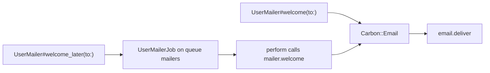

# Mailer

`azu g mailer` writes a `Carbon::Email` subclass under `src/mailers/`: one method per email you name, a `_later` method per email that enqueues a JoobQ job, and the job that sends it. The bodies are stubs, and the Carbon dependency is not added to `shard.yml` for you. Treat the output as a skeleton to finish.

## Overview & visual demo

<figure><figcaption><p><code>azu g</code> lists <code>mailer</code>. Name the mailer for the domain (<code>User</code>), and the command adds the <code>Mailer</code> suffix.</p></figcaption></figure>



## Quickstart & command syntax

```bash
azu g mailer User welcome password_reset
azu g mailer User welcome password_reset --skip job
```



```bash
azu g mailer User welcome password_reset   # welcome and password_reset methods
azu g mailer User                          # a single welcome method
```

Each name after the mailer becomes a method. With none, the mailer gets `welcome`.



```bash
azu g mailer User welcome --skip job
```

`--skip job` leaves out the `welcome_later` method. The job file is still written.



```bash
azu g mailer User welcome --dry-run   # list the files, write nothing
```



| Argument or option | Meaning | Default |
| --- | --- | --- |
| `name` | The domain, such as `User`. The class is `<name>Mailer`, the file `<name>_mailer.cr` | required |
| `methods` | One method per name, in snake case (`password_reset`). Subjects are generated from them | `welcome` |
| `--skip job` | No `_later` methods | off |
| `--force` | Overwrite existing files | off |
| `--dry-run` | List the files, write nothing | off |

Don't put `Mailer` in the name. `azu g mailer UserMailer` writes `class UserMailerMailer`.

## Realistic output


```crystal
# User Mailer
# Email functionality for User using Carbon
# Carbon: https://github.com/luckyframework/carbon
#
# Usage:
#   mailer = UserMailer.new
#   email = mailer.welcome(to: Carbon::Address.new("user@example.com"), name: "John")
#   email.deliver

#
#   # Or send asynchronously:
#   mailer.welcome_later(to: Carbon::Address.new("user@example.com"), name: "John")


require "carbon"

class UserMailer < Carbon::Email
  # Configure mailer defaults
  def from_email : String
    ENV["MAILER_FROM_EMAIL"]? || "noreply@example.com"
  end

  def from_name : String
    ENV["MAILER_FROM_NAME"]? || "User"
  end

    def welcome(to email : Carbon::Address, **params)
      welcome_email(to: email, **params)
    end

    private def welcome_email(to email : Carbon::Address, **params)
      Carbon::Email.new(
        to: email,
        from: Carbon::Address.new(from_email, from_name),
        subject: "Welcome",
        text_body: render_text("user/welcome", params),
        html_body: render_html("user/welcome", params)
      )
    end

    # ... password_reset, with the same shape and subject "Password Reset" ...

  # Deliver welcome email asynchronously
  def welcome_later(to email : Carbon::Address, **params)
    UserMailerJob.enqueue(
      action: "welcome",
      to: email.to_s,
      params: params.to_h
    )
  end

  # Render text template
  private def render_text(template : String, params : NamedTuple) : String
    # TODO: Implement text template rendering
    # You can use ECR, Jinja, or any template engine
    # Example with ECR:
    # ECR.render "src/mailers/templates/#{template}.txt.ecr"

    "Text version of #{template}"
  end

  # Render HTML template
  private def render_html(template : String, params : NamedTuple) : String
    # TODO: Implement HTML template rendering
    # You can use ECR, Jinja, or any template engine
    # Example with ECR:
    # ECR.render "src/mailers/templates/#{template}.html.ecr"

    "<html><body><h1>#{template}</h1></body></html>"
  end
  # ... preview(method_name) and the Carbon adapter block follow ...
```


*Excerpt of the mailer for `azu g mailer User welcome password_reset`. The `password_reset` method repeats `welcome`, and the file ends with a `preview` helper and a Carbon adapter block.*

<details>

<summary>The job that sends it: src/jobs/user_job.cr</summary>

For `azu g mailer User welcome password_reset` the job file is `src/jobs/user_job.cr` and it defines `UserMailerJob`. The header comment says it is generated "when using --async flag"; no such flag exists, and the file is written whether or not you pass `--skip job`.


```crystal
require "../mailers/user_mailer"

struct UserMailerJob
  include JoobQ::Job

  # Queue configuration for mailer jobs
  @queue = "mailers"
  # Retry failed emails up to 3 times
  @retries = 3
  # Expire after 1 hour (JoobQ stores the Unix time in milliseconds)
  @expires = 1.hour.from_now.to_unix_ms

  # Job parameters
  property action : String
  property to : String
  property params : Hash(String, String)

  def initialize(@action : String, @to : String, @params : Hash(String, String) = {} of String => String)
  end

  # Perform the email delivery
  def perform
    mailer = UserMailer.new
    email_address = Carbon::Address.new(@to)

    # Call the appropriate mailer method based on action
    email = case @action

            when "welcome"
              mailer.welcome(to: email_address, **named_tuple_from_params)

            when "password_reset"
              mailer.password_reset(to: email_address, **named_tuple_from_params)

            else
              raise "Unknown mailer action: #{@action}"
            end

    # Deliver the email
    email.deliver

    Log.info { "✓ Email sent: #{@action} to #{@to}" }
  rescue ex : Exception
    Log.error(exception: ex) { "✗ Failed to send email: #{@action} to #{@to}" }
    raise ex # Re-raise for JoobQ's retry mechanism
  end

  # Convert params hash to named tuple for mailer methods
  private def named_tuple_from_params : NamedTuple
    # Convert Hash to NamedTuple for mailer methods
    # This is a simple implementation - you may need to adjust based on your needs
    {} of Symbol => String
  end
end

# Add this job to the registry in src/initializers/joobq.cr:
# JoobQ::QueueFactory.register_job_type(UserMailerJob)
```


*`named_tuple_from_params` always returns an empty hash, so a `_later` call sends the email with no params.*

</details>

## Do's and don'ts


Name the mailer for the domain (`User`, `Order`) and the methods for the emails (`welcome`, `receipt`). One mailer per domain keeps the job and the methods together.



**Pro tip:** register the job the way its comment says, with `JoobQ::QueueFactory.register_job_type(UserMailerJob)` in `src/initializers/joobq.cr`. A job that is not registered is not run by the worker.



Carbon is not in the generated `shard.yml`. The project template comments it out: uncomment `carbon` there and run `shards install` before the mailer compiles.



The bodies are stubs: `render_text` and `render_html` return placeholder strings, and the `_later` methods drop their params. Finish both before you send anything real.



`--force` overwrites a mailer you have started to write. Generate once, then edit the file.


<details>

<summary>Related generators</summary>

- [JoobQ](joobq.md) sets up the queue and worker that run the `_later` methods.
- [Service](service.md) is where the code that decides when to send an email should live.
- The command's full reference is [azu generate](../command-reference/azu-generate.md).

</details>
