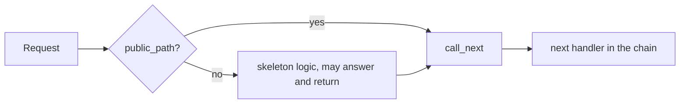

# Middleware

`azu g middleware` writes one `HTTP::Handler` class to `src/middleware/<name>_middleware.cr`. `--type` picks the skeleton: `authentication` (the default), `authorization`, `logging`, `cors` or `rate_limiting`. Any other value gets a custom skeleton. The skeletons are starting points, not finished security code, and the generator doesn't register the handler for you.

## Overview & visual demo

<figure><figcaption><p><code>azu g</code> lists <code>middleware</code> as an HTTP handler. Pick it, then give it a name and a type.</p></figcaption></figure>



## Quickstart & command syntax

```bash
azu g middleware Authentication
azu g middleware Authorization --type authorization
azu g middleware RateLimit --type rate_limiting
azu g middleware Cors --type cors
```



```bash
azu g middleware Authentication                       # --type authentication is the default
```



```bash
azu g middleware RateLimit --type rate_limiting       # writes rate_limit_middleware.cr, class RateLimitMiddleware
```



```bash
azu g middleware Authentication --dry-run             # list the file and its diff, write nothing
```



| Part           | Meaning                                                                                      | Default          |
| -------------- | -------------------------------------------------------------------------------------------- | ---------------- |
| `name`         | CamelCase name. The class is `<Name>Middleware`. The generator doesn't check the name       | required         |
| `--type`       | `authentication`, `authorization`, `logging`, `cors` or `rate_limiting`. Anything else gets the custom skeleton | `authentication` |
| `--force`      | Overwrite an existing file without asking                                                    | off              |
| `--dry-run`    | List files and diffs, write nothing                                                          | off              |

## Realistic output


```text
src/middleware/authentication_middleware.cr
```



```crystal
class AuthenticationMiddleware
  include HTTP::Handler

  def call(context)
    # Skip middleware for certain paths
    if public_path?(context.request.path)
      call_next(context)
      return
    end

    # Check for authentication token
    token = extract_token(context.request)

    unless token && valid_token?(token)
      context.response.status = HTTP::Status::UNAUTHORIZED
      context.response.content_type = "application/json"
      context.response.print({
        "error" => "Authentication required",
        "message" => "Please provide a valid authentication token"
      }.to_json)
      return
    end

    # Add user information to context
    if user = get_user_from_token(token)
      context.set("current_user", user)
    end

    call_next(context)
  end

  private def public_path?(path : String) : Bool
    public_paths = ["/", "/login", "/register", "/health", "/assets"]
    public_paths.any? { |public_path| path.starts_with?(public_path) }
  end

  private def extract_token(request : HTTP::Request) : String?
    # Try Authorization header first
    if auth_header = request.headers["Authorization"]?
      if auth_header.starts_with?("Bearer ")
        return auth_header[7..-1]
      end
    end

    # Try query parameter
    request.query_params["token"]?
  end

  private def valid_token?(token : String) : Bool
    # Implement your token validation logic
    # This could check JWT, database tokens, etc.
    token.size > 10 # Simple validation for demo
  end

  private def get_user_from_token(token : String) : User?
    # Implement user lookup from token
    # This would typically decode JWT or query database
    User.first? # Simple demo
  end
end
```


*The authentication skeleton as generated. Its placeholders are the three methods at the bottom, and the skip list at the top of `public_path?`.*

## Do's and don'ts


**Pro tip:** the name is the class, so `RateLimit --type rate_limiting` gives `RateLimitMiddleware`. Use a plain CamelCase name.



Register the handler in `def self.handlers` in `src/<app>.cr`. The generator doesn't add it, so a middleware file on its own does nothing.



A type the generator doesn't know, including `auth`, gets the custom skeleton. It wraps `call_next` in a `begin`/`rescue` and answers 500 on an error, so replace the TODO with your own logic. The five types are `authentication`, `authorization`, `logging`, `cors` and `rate_limiting`.



As generated, the default skip list starts with `"/"`, and every path starts with `/`. `public_path?` is true for every request, so the token check never runs. Trim the list to the paths you mean to make public before you register the handler.



The token logic is a placeholder. `valid_token?` accepts any token longer than 10 characters, and `get_user_from_token` returns `User.first?`. Replace both before the app handles real users.

