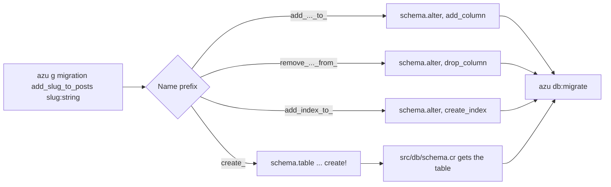

# Migration

`azu g migration` writes one `CQL::Migration` class under `src/db/migrations/`. The name decides what the migration does: `create_comments` makes a table and registers it in `src/db/schema.cr`, `add_slug_to_posts` adds a column, and `remove_title_from_posts` drops one. Run the file with `azu db:migrate`.

## Overview & visual demo

<figure><figcaption><p><code>azu db:migrate</code> runs every migration that is not applied yet. The generator only writes the file.</p></figcaption></figure>



## Quickstart & command syntax

```bash
azu g migration create_comments body:text post_id:int64:ref:posts
azu g migration add_slug_to_posts slug:string
azu db:migrate
```



```bash
azu g migration create_comments body:text post_id:int64:ref:posts
```

A new table, with `id` and the timestamps added for you. `ref:posts` adds the foreign key.



```bash
azu g migration add_slug_to_posts slug:string
azu g migration remove_title_from_posts title:string
```

For `add_`, the columns come from the name (`add_name_and_email_to_users`) and their types from the `name:type` arguments. For `remove_`, the arguments name the columns.



```bash
azu g migration add_index_to_posts slug:string
```

One `create_index` per attribute, named `<column>_idx`.



```bash
azu db:rollback --steps 1      # undo the newest migration
azu db:status                  # applied and pending migrations
```



| Name starts with | What it writes | `up` | `down` |
| --- | --- | --- | --- |
| `create_<table>` | A table, registered in `schema.cr` | `schema.table ... create!` | `drop!` |
| `add_<cols>_to_<table>` | New columns | `add_column` | `drop_column` |
| `remove_<cols>_from_<table>` | Dropped columns | `drop_column` | `add_column` |
| `change_<cols>_in_<table>` | Changed column types | `change_column` | a comment, by hand |
| `add_index_to_<table>` | An index per attribute | `create_index :<col>_idx` | `drop_index` |
| `remove_index_from_<table>` | Removes those indexes | `drop_index` | `create_index` |
| `delete_<table>`, `drop_<table>` | Drops a table | `drop!` | a comment, by hand |
| anything else, such as `update_<table>` | An empty `schema.alter` block to fill in | a comment | a comment |

| Option | Meaning | Default |
| --- | --- | --- |
| `--force` | Overwrite the file if it exists | off |
| `--dry-run` | List the file, write nothing | off |
| `--yes` | Write without asking (a terminal still shows the preview) | off |

Attribute types and modifiers are the same as in the [scaffold](scaffold.md). A migration does not check them: an unknown type becomes a `String` column.

## Realistic output


```crystal
require "cql"

# Migration to create comments table
# Generated at 2026-10-27 21:00:11 UTC
class CreateComments < CQL::Migration(20261027210011_i64)
  def up
    schema.table :comments do
      primary :id, Int64, auto_increment: true
      text :body
      column :post_id, Int64
      timestamps
      foreign_key [:post_id], references: :posts, references_columns: [:id]
    end
    schema.comments.create!
  end

  def down
    # Drop comments table
    schema.comments.drop!
  end
end
```


*The table block is written in the migration and also appended to `src/db/schema.cr`, shown below.*


```crystal
  table :comments do
    primary :id, Int64, auto_increment: true
    text :body
    column :post_id, Int64
    timestamps
    foreign_key [:post_id], references: :posts, references_columns: [:id]
  end
```


*A create migration registers its table here, once. The models read their columns from this file.*


```crystal
require "cql"

# Migration to add columns to posts table
# Generated at 2026-10-27 21:00:11 UTC
class AddSlugToPosts < CQL::Migration(20261027210011_i64)
  def up
    # Add columns to posts table
    schema.alter :posts do
      add_column :slug, String
    end
  end

  def down
    # Remove added columns from posts table
    schema.alter :posts do
      drop_column :slug
    end
  end
end
```


*The file for `add_slug_to_posts slug:string`. Note there is no `index` here: see the warning below.*

## Do's and don'ts


Name each migration for one change, and put indexes in their own `add_index_to_<table>` migration. A single purpose makes the rollback obvious.



**Pro tip:** the generator refuses a second `create_posts` while a migration with the class `CreatePosts` exists. Name a new table migration after the table it creates, and check the list before you generate.



`index` and `unique` on an `add_` migration are ignored. `slug:string:index` writes a plain `add_column :slug, String`. Add the index with `azu g migration add_index_to_posts slug:string`.



Types are not checked here. `name:bogus` writes `text :name`. Check the type against the [scaffold table](scaffold.md) before you run it.



The `down` of a `delete_` or `change_` migration is a comment, not code. Rolling it back does nothing until you write it, and a dropped table cannot be recreated from the file.


<details>

<summary>Migration versions and file names</summary>

The version is a timestamp in UTC. If the newest migration is in the current second or later, the new one takes the second after it, so two generated in the same second never share a version.

The file name is `<version>_<stem>.cr`. For `create_` and table-changing names the stem is the table (`create_comments`). Other names keep their full text (`add_slug_to_posts`), so two changes to one table do not collide.

</details>

<details>

<summary>Running and rolling back</summary>

```bash
azu db:migrate                # run pending migrations
azu db:rollback --steps 2     # undo the newest two
azu db:status                 # what is applied
```

See [database commands](../command-reference/azu-db.md) for the rest.

</details>
