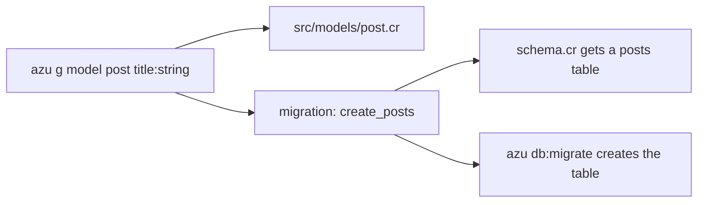

# Model

`azu g model` writes a CQL model to `src/models/` and a create-table migration to `src/db/migrations/`. When `src/db/schema.cr` exists, it also appends the table to that file. The model holds columns and associations only. Validation lives in the request contracts.

## Overview & visual demo

<figure><figcaption><p>After <code>azu g model post</code>, <code>azu db:migrate</code> applies the migration it wrote. Here the <code>CreatePosts</code> migration is applied.</p></figcaption></figure>



## Quickstart & command syntax

```bash
azu g model post title:string body:text published:bool
azu g model comment body:text post_id:references
azu g model user name:string 'email:string:unique' 'nickname:string?'
azu g model post title:string --skip-tests
```



```bash
azu g model post title:string body:text --dry-run   # the files and their diffs, nothing written
```



```bash
azu g model post title:string body:text --check     # type-check with the new model, write nothing on failure
```



```bash
azu g model post title:string --skip-tests          # no migration; you write it yourself
```



| Part           | Meaning                                                                    | Default                    |
| -------------- | -------------------------------------------------------------------------- | -------------------------- |
| `name`         | Singular or plural: `post` and `posts` both make `class Post`              | required                   |
| `attributes`   | `name:type[?][:modifier]`, one per column (see the tables below)           | none                       |
| `--skip-tests` | Skips the migration. Despite the name, it doesn't touch tests              | off                        |
| `--force`      | Overwrite existing files without asking                                    | off                        |
| `--dry-run`    | List files and diffs, write nothing                                        | off                        |
| `--check`      | Type-check with the generated files; write nothing if it doesn't compile   | off                        |
| `--yes`        | Write without asking (the plan is still printed on a terminal)             | off                        |

`created_at` and `updated_at` are always generated. `id`, `created_at` and `updated_at` given as attributes are dropped with a warning.

**Types**

| Type                 | Crystal type | Column                                      |
| -------------------- | ------------ | ------------------------------------------- |
| `string`, `text`     | `String`     | `text :name`                                |
| `int32`, `integer`   | `Int32`      | `column :name, Int32`                       |
| `int64`              | `Int64`      | `column :name, Int64`                       |
| `float32`            | `Float32`    | `column :name, Float32`                     |
| `float64`, `float`   | `Float64`    | `column :name, Float64`                     |
| `bool`, `boolean`    | `Bool`       | `boolean :name, default: false`             |
| `time`, `datetime`   | `Time`       | `column :name, Time`                        |
| `date`               | `Date`       | `column :name, Date`                        |
| `uuid`               | `UUID`       | `column :name, UUID`                        |
| `json`               | `JSON::Any`  | `column :name, JSON::Any`                   |
| `references`, `belongs_to` | `Int64` | `column :name_id, Int64`, plus a `belongs_to` and a foreign key |

**Modifiers**

| Form                  | Effect                                                                  |
| --------------------- | ----------------------------------------------------------------------- |
| `name:string?`        | Nullable: `String?` in the model, `null: true` on the column            |
| `:unique`             | `unique: true` on the column                                            |
| `:index`              | `index: true` on the column                                             |
| `:required`           | Accepted. Columns are `NOT NULL` already, so it changes nothing         |
| `:ref:<table>`        | Foreign key to `<table>`'s `id`, with no `belongs_to` in the model      |
| `comments:has_many`   | An association, no column: `has_many :comments, Comment, foreign_key: :post_id` |

`post_id:references` and `post_id:int64:ref:posts` look alike, but only `references` gives the model a `belongs_to`.

## Realistic output


```text
src/models/post.cr
src/db/migrations/<version>_create_posts.cr
src/db/schema.cr        (changed: a table :posts block is appended)
```


The database name in `db_context` comes from `src/db/schema.cr`. This example uses `BlogDB`, the name in a `blog` project's schema.


```crystal
require "cql"

class Post
  include CQL::ActiveRecord::Model(Int64)
  db_context BlogDB, :posts

  property title : String
  property body : String
  property published : Bool
  property created_at : Time?
  property updated_at : Time?

  def initialize(@title : String, @body : String, @published : Bool)
  end
end
```


*Columns are properties. The constructor takes the attributes, so `Post.new(title: ..., body: ..., published: ...)` works in the services.*


```crystal
require "cql"

# Migration to create posts table
# Generated at 2026-10-27 12:00:00 UTC
class CreatePosts < CQL::Migration(20261027120000_i64)
  def up
    schema.table :posts do
      primary :id, Int64, auto_increment: true
      text :title
      text :body
      boolean :published, default: false
      timestamps
    end
    schema.posts.create!
  end

  def down
    schema.posts.drop!
  end
end
```


*The version is the time you generated the file, so yours differs. The `schema.cr` block mirrors the `table :posts` part.*

A reference adds an association on both sides. This is `comment` with `post_id:references`:


```crystal
require "cql"

class Comment
  include CQL::ActiveRecord::Model(Int64)
  db_context BlogDB, :comments

  property body : String
  property post_id : Int64
  property created_at : Time?
  property updated_at : Time?

  belongs_to :post, Post, foreign_key: :post_id

  def initialize(@body : String, @post_id : Int64)
  end
end
```


*The `belongs_to` line comes from the `references` type. The migration gets a `foreign_key [:post_id], references: :posts` line.*

## Do's and don'ts


**Pro tip:** `--check` type-checks the project with the new model before anything is written. Use it when the model touches code that already exists.



Add a migration for every later change, such as `azu g migration add_slug_to_posts slug:string:index`, instead of editing a migration that already ran. Run `azu db:migrate` to apply it.



Put validations in the request contracts (`azu g request`), not in the model. The model stays a description of the table.



`--skip-tests` skips the migration. Use it only when you write the migration yourself, or the model will point at a table that doesn't exist.



`azu g model` doesn't check types. An unknown type such as `decimal` becomes `String` without a message. `azu g scaffold` rejects unknown types; the model generator does not.



Don't name an attribute after a Crystal keyword or a method the model already has, such as `errors`. The generator refuses those names because the getter would hide the method or not compile at all.

