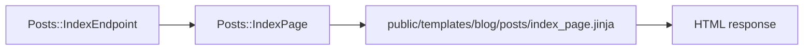

# Page

`azu g page` writes the response of one read action. In a web project that's a page class under `src/pages/<plural>/` and its Jinja template under `public/templates/<app>/<plural>/`. In an API project, or with `--api-only`, it writes a JSON response class under `src/responses/` instead. That only covers `index` and `show`.

## Overview & visual demo

Generate a server-rendered page and its template. Compose reusable UI elements and keep styling consistent with the generated application's daisyUI setup.

<figure><figcaption><p>The scaffold writes the page classes and their Jinja templates together. <code>azu g page</code> writes the pair for the one action you name.</p></figcaption></figure>



## Quickstart & command syntax

```bash
azu g page post index title:string body:text
azu g page post show title:string body:text
azu g page post new
azu g page post edit title:string body:text
```



```bash
azu g page post index title:string body:text         # page class and Jinja template
```



```bash
azu g page post index --api-only                      # src/responses/posts/index_response.cr
azu g page post show --api-only                       # index_response.cr needs this too
```



```bash
azu g page post index title:string body:text --dry-run
```



| Part           | Meaning                                                                          | Default                |
| -------------- | -------------------------------------------------------------------------------- | ---------------------- |
| `name`         | Singular or plural resource name                                                 | required               |
| `action`       | `index`, `show`, `new` or `edit`. With `--api-only`, `index` or `show`           | `index`                |
| `attributes`   | `name:type[?][:modifier]`. The index table gets one column per attribute         | none                   |
| `--api-only`   | Writes the JSON response class instead of the page                               | on in an API project   |
| `--force`      | Overwrite existing files without asking                                          | off                    |
| `--dry-run`    | List files and diffs, write nothing                                              | off                    |
| `--check`      | Type-check with the new files; write nothing if it doesn't compile               | off                    |
| `--yes`        | Write without asking (the plan is still printed on a terminal)                   | off                    |

`new` and `edit` take a `csrf_tag`, which the endpoint passes in. `new` and `edit` templates share a `_form.jinja` partial.

## Realistic output


```text
src/pages/posts/index_page.cr
public/templates/blog/posts/index_page.jinja
```



```crystal
module Blog
  struct Posts::IndexPage
    include Azu::Response::Negotiable
    include Azu::Templates::Renderable

    def initialize(@posts : Array(Post))
    end

    def render_html : String
      view data: {"posts" => @posts.map(&.attributes.transform_keys(&.to_s))}
    end
  end
end
```


*The page turns each record into a hash. `view` renders `public/templates/blog/posts/index_page.jinja` with that data.*

With `--api-only`, the index writes a JSON response that uses the show response for each record:


```crystal
require "json"

module Blog
  struct Posts::IndexResponse
    include Azu::Response::Negotiable

    @records : Array(Posts::ShowResponse)

    def initialize(records : Array(Post))
      @records = records.map { |record| Posts::ShowResponse.new(record) }
    end

    def render_json : String
      @records.to_json
    end
  end
end
```


*`Posts::ShowResponse` comes from `azu g page post show --api-only`. Generate it, or this file won't compile.*

## Do's and don'ts


**Pro tip:** `azu routes` shows the page or response type each endpoint returns. Compare it with the class names you generated.



Pass the same attributes to the page as to the model. The index table gets one column per attribute, so the two lists should match.



Generate `index` and `show` together for an API. The index response depends on the show response.



Don't build a `new` or `edit` page without the `csrf_tag`. The endpoint passes it in, and the form's CSRF field is built from it.



Don't remove the `| e` filters from the generated `.jinja` templates. User values have to be escaped when they're printed into HTML.

