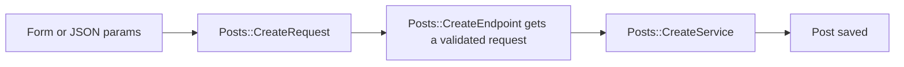

# Request

`azu g request` writes one `Azu::Request` struct per action, under `src/requests/<plural>/`. Create and update carry the resource's attributes. Show, edit and destroy carry the `id` from the route. Index and new carry nothing. The request is where input gets validated, so the endpoint and the service can trust what they receive.

## Overview & visual demo

<figure><figcaption><p>The scaffold's preview lists one request file per action. A single <code>azu g request</code> writes just the one you name.</p></figcaption></figure>



## Quickstart & command syntax

```bash
azu g request post create title:string body:text
azu g request post update title:string body:text
azu g request post show
```



```bash
azu g request post create title:string body:text   # strings are required
```



```bash
azu g request post update title:string body:text   # every field optional, a sent value can't be blank
```



```bash
azu g request post show                            # carries the id only
```



| Part           | Meaning                                                                       | Default              |
| -------------- | ----------------------------------------------------------------------------- | -------------------- |
| `name`         | Singular or plural resource name                                              | required             |
| `action`       | One of `index show new create edit update destroy`                            | `index`              |
| `attributes`   | `name:type[?][:modifier]`. Used by `create` and `update`; ignored otherwise   | none                 |
| `--force`      | Overwrite existing files without asking                                       | off                  |
| `--dry-run`    | List files and diffs, write nothing                                           | off                  |
| `--check`      | Type-check with the new file; write nothing if it doesn't compile            | off                  |
| `--yes`        | Write without asking (the plan is still printed on a terminal)                | off                  |

The attribute types and modifiers are the same as for the model. See [model](model.md).

## Realistic output


```text
src/requests/posts/create_request.cr
src/requests/posts/update_request.cr
src/requests/posts/show_request.cr
src/requests/predicates.cr        (written with update: defines the given? predicate)
```



```crystal
module Blog
  struct Posts::CreateRequest
    include Azu::Request

    getter title : String
    getter body : String

    validate title, presence: true
    validate body, presence: true
  end
end
```


*On create, every string is required. The generator adds `presence` for strings only.*


```crystal
module Blog
  struct Posts::UpdateRequest
    include Azu::Request

    getter title : String?
    getter body : String?

    validate title, given: true
    validate body, given: true
  end
end
```


*On update, each field is optional (PATCH). A value that is sent must not be blank.*


```crystal
module Blog
  struct Posts::ShowRequest
    include Azu::Request

    getter id : Int64
  end
end
```


*The id comes from the route. Show, edit and destroy carry it.*

## Do's and don'ts


**Pro tip:** `azu routes` shows each endpoint's request type next to its response, so you can see which request an action uses.



Give the request, the model and the service the same attributes. The service reads `request.<field>` for each attribute, so a field the request lacks fails to compile.



The generator adds a `validate` line for strings only. Numbers, booleans and times get no rule from it. Add the rules you need by hand.



A boolean on create defaults to `false`, so the request always has a value. On update it is `Bool?`, and an unsent field leaves the record unchanged.



Don't reuse one request for create and update. Create requires the strings and update makes them optional, so keep them as two contracts.

