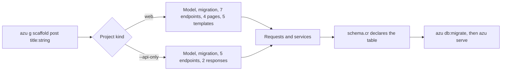

# Scaffold

`azu g scaffold` writes a complete CRUD resource in the Azu contract style: a model and its migration, seven endpoints, request contracts, services, pages and Jinja templates. In an API project, or with `--api-only`, it writes JSON responses instead of pages and templates. [`azu g api_resource`](api-resource.md) is the same generator with the API layout forced on.

For live database CRUD with typed Spark events, paging and updates between open tabs, add `--spark`: `azu generate scaffold Product name:string price_cents:int32 active:bool --spark`. See [Spark components and live scaffolds](spark.md) for supported fields, deployment wiring and authorization boundaries.

## Overview & visual demo

<figure><figcaption><p><code>azu g scaffold comment</code> on a terminal: the file list, the <code>schema.cr</code> diff, and the count to write. Nothing is written until you press Enter.</p></figcaption></figure>



## Quickstart & command syntax

```bash
azu g scaffold post title:string body:text published:bool
azu db:migrate
azu serve
```



```bash
azu g scaffold post title:string body:text published:bool
```

Seven endpoints, four pages and five templates. `new` and `edit` exist because a web app has forms.



```bash
azu g scaffold post title:string body:text --api-only
azu g api_resource post title:string body:text      # the same, as a named generator
```

Five endpoints (no `new` or `edit`) and JSON response classes. An API project gets this without the flag.



```bash
azu g scaffold post title:string body:text --dry-run   # list the files, write nothing
```

On a terminal, `azu g` shows the same preview and waits for Enter; `--dry-run` only lists it.



```bash
azu g scaffold post title:string --skip template,page   # no pages or templates
azu g scaffold post title:string --skip migration       # no migration
azu g scaffold post title:string --skip model           # migration only, no model
```

`--skip` takes a comma-separated list of `model`, `migration`, `endpoint`, `request`, `service`, `page`, `template` and `response`.



| Option | Meaning | Default |
| --- | --- | --- |
| `--api-only` | JSON responses, no pages or templates, no `new` or `edit` | off (on in an API project) |
| `--web-only` | Pages and templates even in an API project | off |
| `--skip LIST` | Leave out the listed components | none |
| `--force` | Overwrite existing files | off |
| `--dry-run` | List the files and changes, write nothing | off |
| `--check` | Type-check the project with the new files before writing | off |
| `--yes` | Write without asking (a terminal still shows the preview) | off |
| `--ui MODE` | `rich` or `plain` | `rich` on a terminal |

The name is the resource. `Post`, `posts` and `post` all mean the same resource. A name is refused when it is not a Crystal identifier, when its singular and plural are the same, or when it would hide a constant the generated code uses (`Status`, `Request`, `Response` and so on).

Attributes are `name:type[:modifier]`. A trailing `?` on the type makes the column nullable.

| Type | Crystal type | Column and form |
| --- | --- | --- |
| `string`, `email`, `url` | `String` | `text` column, `<input type="text">` |
| `text` | `String` | `text` column, `<textarea>` |
| `int32`, `integer` | `Int32` | `column :n, Int32`, number input |
| `int64` | `Int64` | `column :n, Int64`, number input |
| `float32`, `float64`, `float` | `Float32`, `Float64` | number input |
| `bool`, `boolean` | `Bool` | `boolean ..., default: false`, checkbox |
| `time`, `datetime`, `date` | `Time`, `Date` | `column` |
| `json`, `uuid` | `JSON::Any`, `UUID` | `column` |
| `references`, `belongs_to` | `Int64` | foreign key, see below |

| Modifier | Effect on the column |
| --- | --- |
| `unique` | `unique: true` |
| `index` | `index: true` |
| `required` | Accepted; NOT NULL is already the default |
| `ref:<table>` | Foreign key to `<table>` (`post_id:int64:ref:posts`) |

`user_id:references` and `post_id:belongs_to` derive the table from the name (`users`, `posts`). They add a foreign key and a `belongs_to` on the model.

## Realistic output


```text
public/templates/blog/posts/     _form, edit_page, index_page, new_page, show_page  (.jinja)
src/db/migrations/<version>_create_posts.cr
src/db/schema.cr                 changed: adds the posts table
src/endpoints/posts/             create, destroy, edit, index, new, show, update  _endpoint.cr
src/models/post.cr
src/pages/posts/                 edit, index, new, show  _page.cr
src/requests/posts/              create, destroy, edit, index, new, show, update  _request.cr
src/requests/predicates.cr
src/services/posts/              create, destroy, update  _service.cr
```


*The web scaffold writes 29 new files and changes `src/db/schema.cr`. It writes no spec files.*


```crystal
require "cql"

class Post
  include CQL::ActiveRecord::Model(Int64)
  db_context BlogDB, :posts

  property title : String
  property body : String
  property published : Bool
  property created_at : Time?
  property updated_at : Time?

  def initialize(@title : String, @body : String, @published : Bool)
  end
end
```


*The model declares columns and the table. Validation lives in the request, not here.*


```crystal
require "cql"

# Migration to create posts table
# Generated at 2026-10-27 20:59:52 UTC
class CreatePosts < CQL::Migration(20261027205952_i64)
  def up
    schema.table :posts do
      primary :id, Int64, auto_increment: true
      text :title
      text :body
      boolean :published, default: false
      timestamps
    end
    schema.posts.create!
  end

  def down
    # Drop posts table
    schema.posts.drop!
  end
end
```


*The same `table` block is appended to `src/db/schema.cr`, where the models find their columns.*


```crystal
module Blog
  struct Posts::CreateEndpoint
    include Azu::Endpoint(Posts::CreateRequest, Azu::Response::Empty)

    post "/posts"

    def call : Azu::Response::Empty
      record = Posts::CreateService.new.call(create_request)
      redirect to: "/posts/#{record.id}", status: 303
    end
  end
end
```


*A write redirects with 303. One endpoint has one response type.*


```crystal
module Blog
  struct Posts::CreateRequest
    include Azu::Request

    getter title : String
    getter body : String
    getter published : Bool = false

    validate title, presence: true
    validate body, presence: true
  end
end
```


*Non-nullable strings must be present. The boolean defaults to `false`.*


```crystal
module Blog
  class Posts::CreateService
    def call(request : Posts::CreateRequest) : Post
      record = Post.new(title: request.title, body: request.body, published: request.published)
      record.save!
      record
    end
  end
end
```


*The service saves the record. The endpoint only calls it and redirects.*


```jinja
<form action="{{ form_action }}" method="post" class="stack">
  {{ csrf_tag | safe }}
  <input type="hidden" name="_method" value="{{ form_method }}">
  <label class="field">Title
    <input type="text" name="title" value="{{ post.title | e }}" required>
  </label>
  <label class="field">Body
    <textarea name="body" rows="6" required>{{ post.body | e }}</textarea>
  </label>
  <label class="field field--check">
    <input type="hidden" name="published" value="false">
    <input type="checkbox" name="published" value="true" checked>
    Published
  </label>
  <div class="row">
    <button class="btn" type="submit">Save</button>
    <a class="btn btn--secondary" href="/posts">Cancel</a>
  </div>
</form>
```


*The shared form partial for `new` and `edit`. Values are escaped with `| e`; the CSRF field is printed with `| safe` because the helper builds it.*

<details>

<summary>The update side and the API layout</summary>

Update is the same shape: `Posts::UpdateEndpoint` loads the record, `Posts::UpdateService` assigns each field that the PATCH carries, and the request declares every field optional with `validate title, given: true`.

With `--api-only`, the tree changes to `src/responses/posts/index_response.cr` and `show_response.cr` in place of `src/pages/`, and the templates go. The endpoints answer JSON, and `create` answers `201`.

</details>

## Do's and don'ts


**Pro tip:** run `azu g scaffold ... --dry-run` first. It lists every file and the lines in each, so you can see what `--skip` and `--api-only` leave out before anything is written.



Commit or stash your work before you scaffold. Then the diff of `src/db/schema.cr` and the new files is the only thing to review.



Existing files are kept, not overwritten, unless you pass `--force`. A second `create_posts` migration is refused when `CreatePosts` already exists, so a scaffold for a resource you already have stops at the migration step. Remove the old files or pick another name.



Attribute types are checked here. A `title:foo` stops the run with `Unsupported attribute type 'foo'`. `id`, `created_at` and `updated_at` are left out because the model provides them.



`--force` overwrites the endpoints, services and pages you have edited since the last scaffold. Generate once, then change the files you own.


<details>

<summary>Related generators</summary>

- [Endpoint](endpoint.md), [Page](page.md), [Service](service.md) and [Request](request.md) are the single-layer generators the scaffold runs.
- [Migration](migration.md) adds columns to an existing table. Prefer it to scaffolding over a table you have already changed.
- [API resource](api-resource.md) is the same scaffold with the API layout.
- The command's own reference is in [azu generate](../command-reference/azu-generate.md).

</details>
