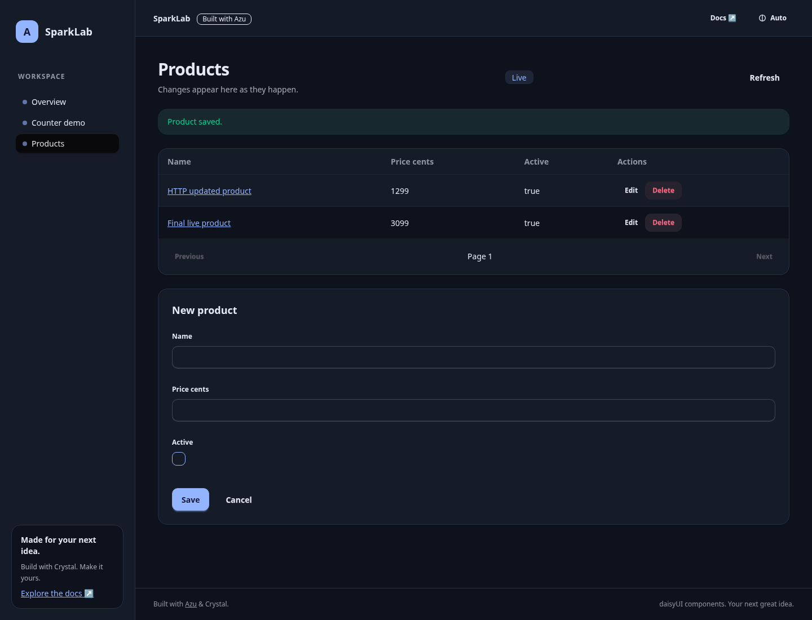
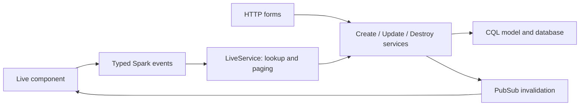

# Spark components and live scaffolds

## Overview & visual demo

`azu generate spark` creates a stateful `Azu::Spark::Component` with typed events. `azu generate scaffold --spark` creates a complete database-backed CRUD interface: list, create, edit, validation, confirmed deletion and updates between open tabs. Both use the generated app's daisyUI theme and Azu's locally served Spark client.

<figure><figcaption><p>A real generated SQLite application exercised in Chromium.</p></figcaption></figure>



## Quickstart & command syntax

Run inside a generated **web** project. The browser acceptance fixture uses Azu **0.10.5**, CQL **0.0.604** and Crystal **1.22.1**. Existing projects need the typed Spark API (`state`, `event`, `mountable`); update their Azu dependency before using these generators if that API is absent:

```sh
azu generate spark Counter count:int32 title:string enabled:bool --page
azu generate scaffold Product name:string price_cents:int32 active:bool --spark
azu db:setup
azu serve
```

See the [generated counter screenshot](../assets/generated-ui/spark-counter.png).

Visit `/counters/live` for the component demo and `/products` for live CRUD. Both pages register in the application navigation. Open `/products` in two tabs to see committed changes refresh the other tab.

```sh
# Equivalent aliases:
azu generate spark:component Counter count:int32 --page
azu generate spark:scaffold Product name:string price_cents:int32 active:bool
# Review files and wiring without changing the project:
azu generate spark Counter count:int32 --page --dry-run
```

| Option | Behavior |
| --- | --- |
| `--page` | Standalone component only: adds request, endpoint, page, template and navigation entry |
| `--spark` | Scaffold only: replaces its index with a live CRUD screen; retains HTTP forms and detail pages |
| `--dry-run`, `--check`, `--force`, `--yes` | Standard generator preview, compilation and write controls |

Supported fields are **required scalars**: `string`, `text`, `email`, `url`, `int32`/`integer`, `int64`, `float32`, `float64`/`float`, and `bool`/`boolean`. A standalone component with no fields gets `count:int32`. Nullable fields, dates, JSON, UUID, relationships and column modifiers are rejected before writing; use the standard scaffold for those types and adapt its live interface explicitly. Live scaffolds require all layers, so `--skip` and API-only mode are rejected.

## Realistic output

```text
# azu generate spark Counter count:int32 --page
src/components/counter_spark.cr
spec/components/counter_spark_spec.cr
src/initializers/spark.cr
src/requests/counters/live_request.cr
src/endpoints/counters/live_endpoint.cr
src/pages/counters/live_page.cr
public/templates/<app>/counters/live_page.jinja

# azu generate scaffold Product ... --spark (in addition to standard CRUD)
src/components/products/live_component.cr
src/services/products/live_service.cr
# Replaces the index endpoint/page/template with the live component.
# Create/Update/Destroy services publish invalidations after successful writes.
```

The component generator emits `state`, `change_<field>` events, numeric increment events and `reset`. Embed a component without a demo page using `Azu::Spark.render(MyApp::CounterSpark)` and include `Azu::Spark.script_tag` once on that page. The generated page demonstrates this integration; don't mark arbitrary user HTML as trusted.

The live scaffold separates UI state from persistence. `LiveComponent` owns the editor, notices and confirmation state. `LiveService` handles lookup, 25-row paging (fetching one extra row to detect the next page), and delegates writes to the existing services. The HTTP and Spark paths share requests, validation and writes. The component escapes displayed values, keeps the editor on validation failures and shows safe feedback for persistence failures while logging the exception on the server.

Save/delete events use Spark's `at-most-once` delivery mode: ambiguous writes aren't automatically replayed after a disconnect. This is **not** a database exactly-once guarantee. Refresh and confirm the persisted state after a lost response. Generated CRUD uses ordinary last-write-wins updates; add optimistic locking if concurrent edits must be rejected.

## Wiring and deployment

The generator installs `src/initializers/spark.cr` with `Azu::Spark.install` once, adds a random `SPARK_SECRET` to `.env` with owner-only permissions, and preserves an existing initializer or secret. A symlinked `.env` is left alone with a message to set the environment variable. Keep a stable secret in your deployment's secret manager and share it among instances; never commit `.env`. Production Spark requires a valid secret. The client script is served by the app at `/_spark/azu_spark.js`; the proxy must support WebSocket upgrades on `/spark`.

PubSub is in-memory by default: updates reach connected tabs in the **same app process**. For multiple processes/instances, configure Azu's Redis PubSub backend and validate that topology. Direct database writes do not emit invalidations; route writes through the generated services or publish the same topic explicitly. These notifications invalidate a view; they are not a durable event log.

The initial server render disables live controls until Spark connects. Without JavaScript, a link leads to the standard HTTP form. These forms and detail pages remain available for progressive enhancement. The generated Tailwind sources include `src/components` so rebuilt CSS includes custom component classes.

## Do's and don'ts


Keep business rules in services and typed requests; keep rendering and interaction state in the component. Customize the generated files directly rather than maintaining a second persistence path in event handlers.



Like the standard scaffold, generated CRUD is public. Before handling private data, implement authentication and authorization in both HTTP and live paths, pass trusted session claims into Spark, scope queries and PubSub topics by tenant, and test access boundaries. A signed Spark join token is not a record authorization policy.



`azu generate component` remains the static `Azu::Component` generator. Use `spark` for stateful events and live rendering. `--force` overwrites generated files; review its preview before replacing custom logic.


Run `scripts/e2e_spark_app.sh` from the CLI repository after building `bin/azu` to generate, migrate, compile and click through a disposable SQLite app in Chromium. It requires Crystal/shards, Redis, Python Playwright and Chromium, retains its logs/screenshots/trace, and stops only the processes it starts.
