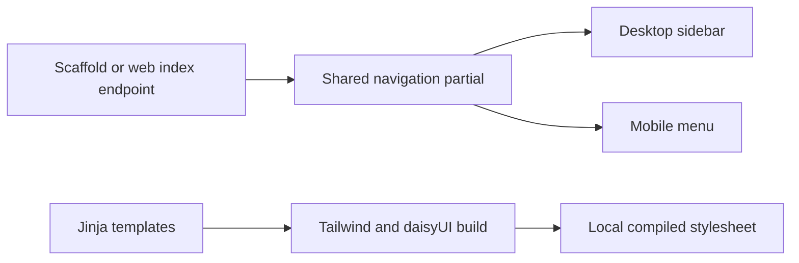
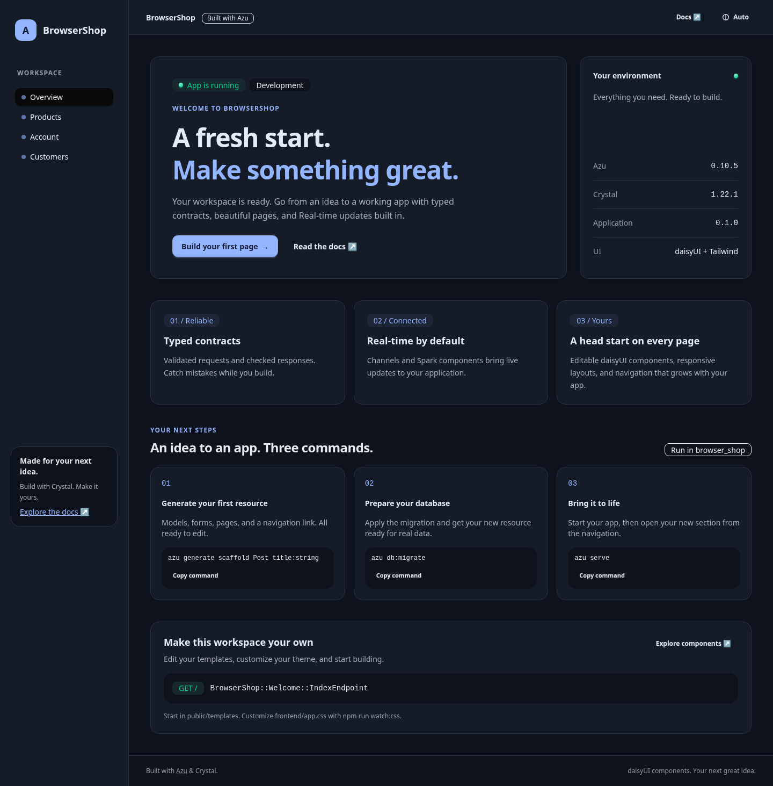

# Generated UI and navigation

## Overview

New web projects use **daisyUI 5.7.50 and Tailwind CSS 4.3.3**. The welcome page, scaffold pages, authentication and account page share a responsive layout with a desktop sidebar, mobile menu, light/dark themes and keyboard focus indicators. Forms use daisyUI inputs, checkboxes and buttons; collections have empty states and scrollable tables; account pages use an avatar placeholder. Destructive scaffold actions show a confirmation dialog when JavaScript is available.


Compiled styles ship with each new app. Node is needed only to rebuild or customize CSS.




<figure><figcaption>A real generated app running in Chromium.</figcaption></figure>

## Quickstart

```sh
azu new shop --type web --db sqlite
cd shop
azu generate scaffold Product name:string price_cents:int32 active:bool
azu generate auth
azu db:setup
azu dev
```

Open the app and select **Products** or **Account** from the navigation. Generators ship working HTML forms with CSRF tokens and method overrides; the appearance does not replace the request contracts, services or persistence layer.

## Realistic output

```text
Scaffold generation completed
Generated components: model, endpoint, service, request, page, template
Next: azu db:setup, then azu serve
```

The generated Products section leads to an empty state. Creating a product opens its detail page; Edit opens a prefilled form and Delete asks for confirmation.

Compiled CSS is included in `public/assets/app.css`. Running the generated application requires neither Node nor a CDN. Assets load from your application origin and do not require inline styles, inline scripts or a browser Tailwind compiler.

## Customize the UI

| File | Purpose |
| --- | --- |
| `public/templates/app_layout.jinja` | Shared shell, sidebar, mobile menu and delete dialog |
| `public/templates/helpers/_sections.jinja` | Editable application sections |
| `public/templates/<app>/<resource>/` | List, detail, edit/new pages and shared form |
| `frontend/app.css` | Tailwind sources, daisyUI plugins and theme settings |
| `frontend/generator-classes.txt` | Classes retained for future scaffolds/auth pages |
| `public/assets/app.js` | Theme control, active links, mobile menu, copy buttons and delete confirmation |

Use component classes directly in your templates:

```html
<section class="card border border-base-300 bg-base-100">
  <div class="card-body">
    <h2 class="card-title">Your next feature</h2>
    <p>Make this workspace your own.</p>
    <a class="btn btn-primary" href="/products">Browse products</a>
  </div>
</section>
```

To add utility classes or change theme colors, install Node.js 20+:

```sh
npm ci
npm run watch:css  # alongside azu dev; refresh the browser after CSS changes
```

Before deploying, run `npm run build:css` and include the resulting `public/assets/app.css`. Versions and integrity hashes are pinned in `package-lock.json`. Keep `frontend/generator-classes.txt` while using generators: it ensures newly generated components stay styled even if you rebuilt CSS before creating those pages. Generated templates remain ordinary editable Jinja files.

See the [daisyUI components](https://daisyui.com/components/) and [avatar documentation](https://daisyui.com/components/avatar/).

## Automatic section registration

Generating a web scaffold or `azu generate endpoint Product index` registers `/products`. Authentication registers `/account`. Registration applies to collection **GET index** endpoints; API endpoints, write actions, `new`, and member routes requiring `:id` do not become application sections. Standalone endpoint generators still require the corresponding model, request and page; use a scaffold for a complete CRUD flow.

Desktop and mobile navigation render the same `_sections.jinja` partial. Change labels/order and add links freely. Keep this marker where new sections should be inserted:

```jinja
<li><a href="/reports" data-nav-link>Reports</a></li>
{# azu:sections:end #}
```

Repeated generation does not duplicate an existing destination or replace its custom label. `--dry-run` previews navigation changes without writing them; interactive generation includes them in the file review and undo record. Active links match complete path segments, so `/products/1/edit` highlights Products and `/products_archive` does not.

Older/custom projects without this partial remain untouched. To adopt registration, create the partial with the marker and include it inside your layout's navigation list. A project that already owns its styles can adopt daisyUI through its own asset build; `azu generate` does not overwrite the application's layout or dependencies.


Keep `{# azu:sections:end #}` in your navigation partial if you want future generators to append sections. Removing the marker opts out of automatic registration.


The legacy `layout.jinja` delegates its `page_body` block to the same shared shell. Bootstrap assets and CDN scripts are no longer generated.

## Do's and don'ts

- Edit Jinja templates and `frontend/app.css`; treat `public/assets/app.css` as build output.
- Keep the lockfile and class manifest when customizing styles.
- Rebuild CSS before deployment after adding new utility classes.
- Do not add API write routes or parameterized member URLs to application navigation.
- Use a scaffold for a complete CRUD flow; an endpoint alone needs its supporting application code.

## Contributor checks

After changing generator markup or frontend dependencies, run `sh scripts/build_frontend_assets.sh` to regenerate the class manifest and bundled CSS. Run `sh scripts/e2e_browser_app.sh` to generate an application, exercise navigation/forms/authentication in Chromium, and verify migration recovery and session persistence across restart. It retains screenshots and a report in its temporary directory.
