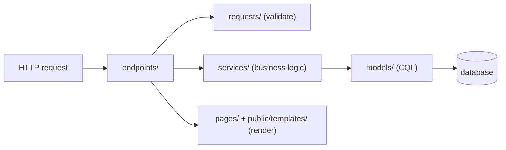

# Project structure

Every generator writes to a predictable place with a predictable name, so you can find code without searching. This page is the map.

## Overview & visual demo

<figure><figcaption><p>A scaffold's files, as they land in the tree: templates, migration, schema change, endpoints, model, pages, requests and services.</p></figcaption></figure>



## Quickstart & command syntax

```bash
azu new blog --yes && cd blog
azu g scaffold post title:string body:text
```




```text
src/
├── blog.cr  server.cr         # the app, and its entry point
├── endpoints/                 # HTTP handlers
├── requests/                  # request structs and validation
├── pages/                     # responses that render templates
├── services/                  # business logic
├── models/                    # CQL models
├── jobs/  channels/  middleware/  initializers/
└── db/
    ├── migrations/            # <version>_<name>.cr
    ├── schema.cr              # every table, added by the generators
    └── seed.cr
public/templates/<app>/        # Jinja templates (never served as static files)
spec/  config/
.env  .env.example  .env.development  .env.test
shard.yml
```




Same layout without `public/` and the pages: endpoints answer with JSON, and the entry point is `src/api.cr`.



```text
src/blog.cr        # the program
spec/
shard.yml          # target: src/blog.cr
```
No server, database, jobs or `.env`.



The naming scheme for a resource `Post` in an app called `Blog`:

| Layer     | File                                         | Class                          |
| --------- | -------------------------------------------- | ------------------------------ |
| Endpoint  | `src/endpoints/posts/create_endpoint.cr`     | `Blog::Posts::CreateEndpoint`  |
| Request   | `src/requests/posts/create_request.cr`       | `Blog::Posts::CreateRequest`   |
| Page      | `src/pages/posts/show_page.cr`               | `Blog::Posts::ShowPage`        |
| Service   | `src/services/posts/create_service.cr`       | `Blog::Posts::CreateService`   |
| Template  | `public/templates/blog/posts/show_page.jinja` |                               |
| Model     | `src/models/post.cr`                         | `Post`                         |
| Migration | `src/db/migrations/<version>_create_posts.cr` | `CreatePosts`                 |

## Realistic output


```crystal
table :comments do
  primary :id, Int64, auto_increment: true
  text :body
  column :post_id, Int64
  timestamps
end
```


*The generators add each table to `schema.cr` once. This is the diff the preview shows for a `comment` scaffold with `body:text post_id:int64`.*

## Do's and don'ts


**Pro tip:** `azu routes` shows the same naming from the other side: every route with its endpoint, request and response types.



Keep logic in `services/` and keep endpoints thin. The generated endpoints already call a service for writes.



The app requires `./db/schema` only. `src/db/seed.cr` is run by `azu db:seed`, not on every boot.



Don't serve `public/templates/` yourself. The generated app refuses to serve `.jinja` files as static files, and so should anything in front of it.


<details>

<summary>Reserved names</summary>

Generated resource names avoid reserved ones such as `Templates`, so a resource can't shadow a framework route. The generator tells you when a name is refused.

</details>
