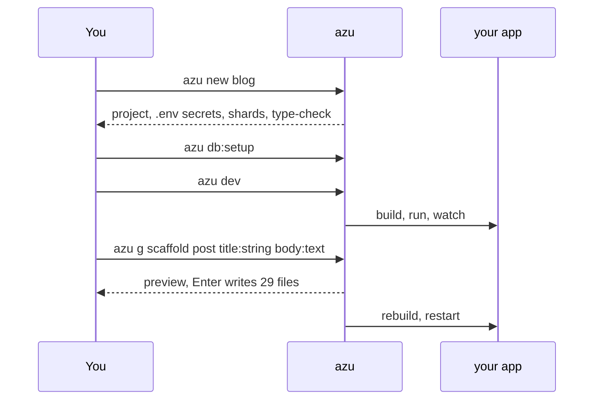

# Quickstart

Create, run and extend your first Azu app in about a minute of typing.

## Overview

You will create a web project, set up its SQLite database, start the dev server and scaffold a CRUD resource while it
runs. Nothing here needs a database server.



## Quickstart

### 1. Create the project

```bash
azu new blog
cd blog
```

On a terminal you get a wizard (module, author, type, database, tests, jobs, extras), a review screen and a live
progress card. Add `--yes` to take the defaults and skip the wizard.

<figure><figcaption><p>The wizard. Every answer is a flag; the review screen prints them as one <code>azu new ... --yes</code> line.</p></figcaption></figure>

### 2. Set up the database

```bash
azu db:setup     # creates db/blog_development.db and runs the migrations
```

### 3. Run it

```bash
azu dev
```

Open <http://localhost:4000>. Saving a file under `src/` rebuilds and restarts the app; saving a template under
`public/templates/` reloads it without a build.

<figure><figcaption><p>The <code>azu dev</code> dashboard: build, app, requests, SQL, jobs and the log.</p></figcaption></figure>

### 4. Generate a resource

In a second terminal, in the project directory:

```bash
azu g scaffold post title:string body:text
```

The generator runs in a scratch copy first and shows what it would write. **Enter** writes exactly those files, **Esc**
writes nothing.

<figure><figcaption><p>The preview: new files marked <code>+</code>, changed files <code>~</code> with their diff, and a type-check result underneath.</p></figcaption></figure>

Then migrate and look at it:

```bash
azu db:migrate
```

Visit <http://localhost:4000/posts>.

### 5. Look around

```bash
azu routes       # every route with its request and response types
azu doctor       # environment checks
azu undo         # take the last generate back
```

## Output

What `azu new blog` ends with (plain mode):

```text
✔ Files       63 written into ./blog
✔ Secrets     .env (0600) · CSRF_SECRET
✔ Git         init + 1 commit
✔ Shards      15 installed
✔ Type-check  src/server.cr

blog is ready
  $ cd blog
  $ azu db:setup
  $ azu serve
  Visit: http://localhost:4000
```


The numbers and timings above come from a real run and vary by machine. The card also suggests `azu serve`; prefer
`azu dev` while developing.


## Do's and don'ts


Commit the preview habit: look at the file list before pressing Enter. `azu undo` is there, but reading first is faster.



`azu new` never overwrites a directory. If `blog` exists, pick another name.



Do not commit `.env`. It holds random secrets, is git-ignored and is written with mode 0600. Commit `.env.example`.


<details>

<summary>Port already in use, or the app does not start</summary>

```bash
azu doctor                 # checks the port, database, secrets and dependencies
azu dev --port 4001
azu db:status
```

</details>

## Next

- [azu new](../command-reference/azu-new.md), [azu dev](../command-reference/azu-dev.md), [azu generate](../command-reference/azu-generate.md)
- [Project structure](project-structure.md)
