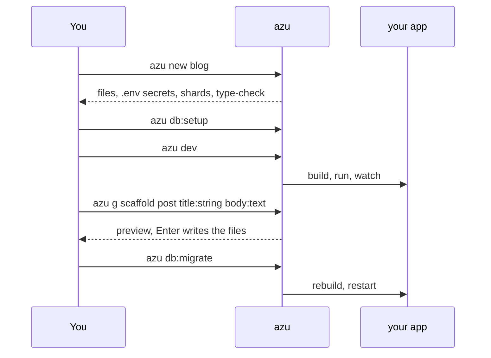
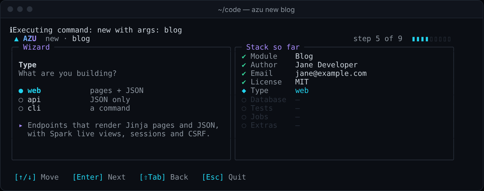
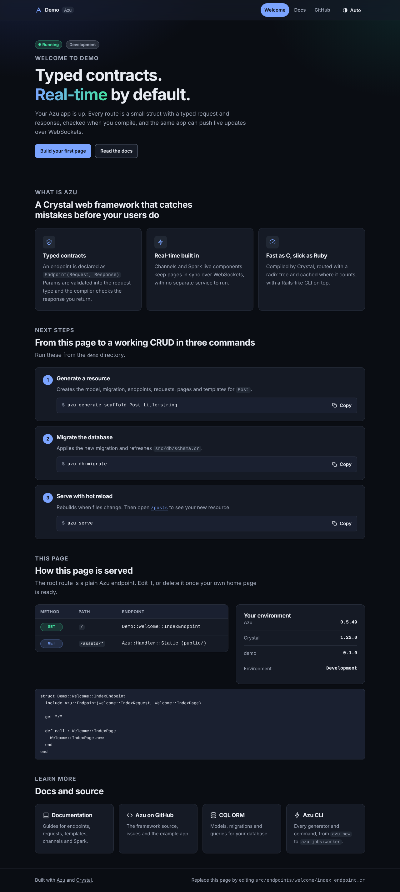
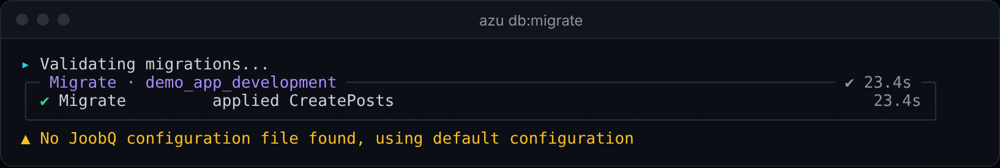

# Quickstart

Create a web project, start the dev server and scaffold a CRUD resource while it runs. No database server needed.

## Overview & visual demo

<figure><figcaption><p>Where you'll be after step 1: the project exists, its secrets are written, and the card tells you what to run next.</p></figcaption></figure>



## Quickstart & command syntax

### 1. Create the project

```bash
azu new blog
cd blog
```

On a terminal you get a wizard, a review screen and a live progress card. Add `--yes` to take the defaults.

<figure><figcaption><p>Step 5 of 9. Answers so far sit on the right; Shift-Tab goes back, Esc cancels and writes nothing.</p></figcaption></figure>

<figure><figcaption><p>The spinner is on <code>shards install</code>. Finished steps show a ✔ and their time.</p></figcaption></figure>

### 2. Set up the database

```bash
azu db:setup     # creates db/blog_development.db and runs the migrations
```

### 3. Run it

```bash
azu dev
```

Open <http://localhost:4000>.

<figure><figcaption><p>The page a new app serves at <code>/</code>. It lists the next three commands.</p></figcaption></figure>

Save a file under `src/` and the app rebuilds and restarts. Save a template under `public/templates/` and it reloads with no build.

<figure><figcaption><p>The <code>azu dev</code> dashboard: 50 s first build, 25 requests, 12 queries and the live log. The Jobs panel warns because Redis isn't running.</p></figcaption></figure>

### 4. Generate a resource

In a second terminal, from the project directory:

```bash
azu g scaffold post title:string body:text
```

The generator runs in a scratch copy and shows what it would write. **Enter** writes exactly those files; **Esc** writes nothing.

<figure><figcaption><p>New files are <code>+</code>, changed files <code>~</code> with their diff. <code>src/db/schema.cr</code> gets the new table, and the project still type-checks.</p></figcaption></figure>

Then migrate:

```bash
azu db:migrate
```

<figure><figcaption><p>One migration applied. The yellow line is a warning that no JoobQ config file was found; it doesn't stop the migration.</p></figcaption></figure>

Visit <http://localhost:4000/posts>.

### 5. Look around

```bash
azu routes       # every route with its request and response types
azu doctor       # environment checks
azu undo         # take the last generate back
```

| Command         | What you get                                         | Details                                          |
| --------------- | ---------------------------------------------------- | ------------------------------------------------ |
| `azu routes`    | Verb, path, endpoint, request and response types     | [azu routes](../command-reference/azu-routes.md) |
| `azu doctor`    | 9 checks, nothing changed                            | [azu doctor](../commands/doctor.md)              |
| `azu undo`      | Reverts the last preview-written generate            | [azu generate](../command-reference/azu-generate.md) |

## Realistic output


```text
✔ Files       63 written into ./blog
✔ Secrets     .env (0600) · CSRF_SECRET
✔ Git         init + 1 commit
✔ Shards      15 installed
✔ Type-check  src/server.cr

blog is ready
  $ cd blog
  $ azu db:setup
  $ azu serve
  Visit: http://localhost:4000
```


*Counts and timings are from a real run and vary by machine. The card also suggests `azu serve`; use `azu dev` while developing.*

## Do's and don'ts


**Pro tip:** `azu new` prints the equivalent `azu new ... --yes` command on its review screen. Copy it to repeat the setup in CI.



Read the file list before you press Enter. `azu undo` can take it back, but reading first is quicker.



`azu new` never overwrites a directory. If `blog` exists, pick another name.



Don't commit `.env`. It holds random secrets, is git-ignored and is written with mode 0600. Commit `.env.example`.


<details>

<summary>Port in use, or the app won't start</summary>

```bash
azu doctor                 # checks the port, database, secrets and dependencies
azu dev --port 4001
azu db:status
```

</details>

## Next

- [azu new](../command-reference/azu-new.md) · [azu dev](../command-reference/azu-dev.md) · [azu generate](../command-reference/azu-generate.md)
- [Project structure](project-structure.md)
