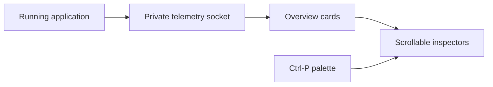

# Terminal UI

## Overview & visual demo

`azu dev` combines Azu's browser dashboard metrics with local development tools. Overview uses five aligned metric cards per row when space allows, followed by side-by-side latest logs and SQL queries. Tab focuses either feed, `j/k` or PgUp/PgDn scrolls it, and Enter opens its full inspector. Narrow terminals reduce columns; shorter terminals give the feeds a separate `[` / `]` page. Its header identifies the application, section, process state, PID, and port. The sidebar groups observation, data, jobs, and development features.

<figure><figcaption><p>Real renderer, sample data. The grid adapts to your terminal.</p></figcaption></figure>



## Quickstart & command syntax

```bash
azu dev
azu dev --ui plain
```

Rich mode uses the terminal's alternate screen and restores it on exit. `--ui rich` and `--ui mission` select the same workspace. Plain mode is useful for pipes, logs, and restricted terminals.

| Key | Action |
| --- | --- |
| Ctrl-P | Search views and commands |
| `h`, Esc | Open or close contextual help |
| `b` | Collapse or expand the sidebar |
| `[` / `]` | Change Overview pages or Database subviews |
| Tab / Shift-Tab | Change card or inspector focus |
| arrows, `j` / `k` | Select a card or list item |
| Enter | Inspect the selection |
| `/`, Esc | Filter, then clear the filter |
| PageUp / PageDown | Scroll the focused list or details |
| `g`, `:` | Compose a generator or command |
| `c` | Open the local console |
| `q` | Quit; disconnect in production monitoring |

Text-entry views keep letters as input. Ctrl-P remains available from the console. At widths below 104 columns, use the palette instead of the sidebar. Overview pages keep the header and footer fixed; long details scroll inside their viewport.

### Find the right screen

| Group | Views and purpose |
| --- | --- |
| Observe | Overview health/cards; Errors and exception details; Tracing distributions/endpoints; highlighted Logs; Profiler spans and GC trend |
| Data & Access | Sessions lifecycle and backend; Database summary, SQL/pool, schema, migrations; Cache operations |
| Jobs | JoobQ workers/workflows/DLQ; Queues & Activity counters |
| Develop | Components lifecycle; Mailers delivery outcomes and static previews |

Build, console, commands, configuration, and routes remain available through Ctrl-P. SQL is a Database subview; the `5` shortcut still opens its inspector.

## Realistic output

```text
System health
100 · All systems nominal
Health of recorded traffic

Uptime          Memory (RSS)     Latency           Active routes
4m 44s          28.7 MB          0.15 ms p50       15
Since ...       GC heap 5.8 MB   16.7 ms p99       9 GET / 3 POST / ...

Page 1/2 · [ / ] page · Tab select · Enter inspect
```

*Illustrative values. The health score describes recorded traffic, not a deployment readiness certification.*

## Do's and don'ts


**Read the state.** Disabled features are hidden. Enabled features with no samples show an empty state. Missing adapters show unavailable. A stale feed keeps its last sample marked stale.



**Counts have scope.** Cookie sessions cannot report an active-session inventory. Redis connectivity does not prove workers are running. Overview graphs use filled bars with a zero baseline, scaled to the visible peak. When samples must be grouped, each bar retains the highest value in its group. Memory graphs show GC heap samples; the RSS number is separate. ASCII terminals use `#` and `+` bars.



**Inspect safely.** JoobQ replay requires confirmation. Sessions and Mailers are inspection views: they do not revoke sessions or send messages. Production connections retain their read-only restrictions.

