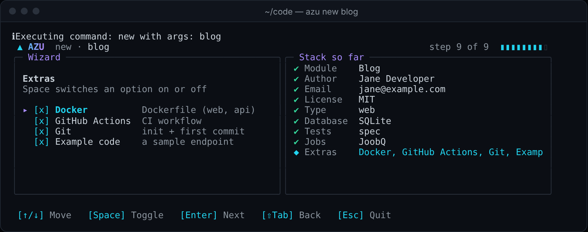
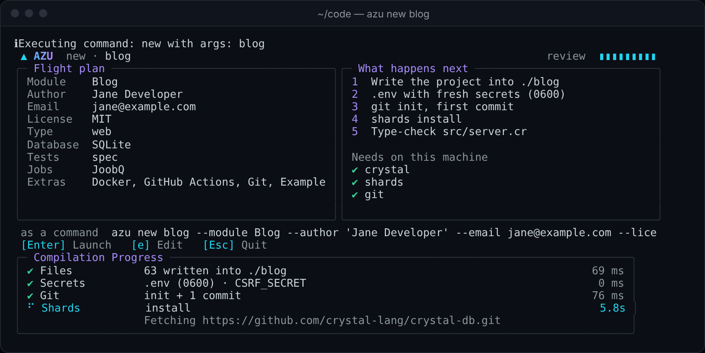
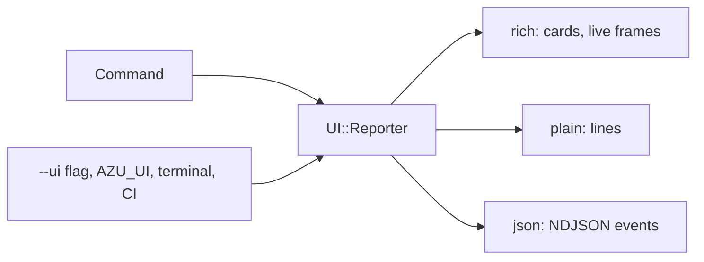
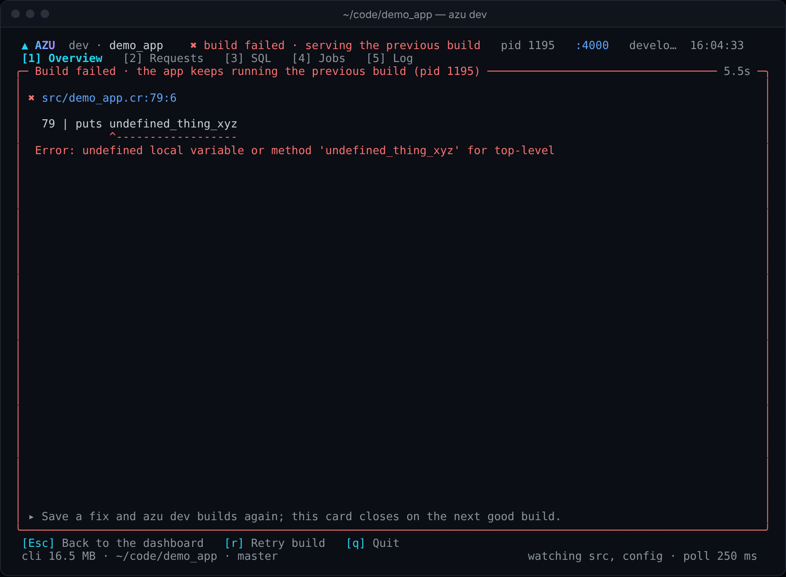

# Terminal UI

Every azu command that draws something has two other forms: plain lines and JSON. The rich form needs a color terminal; pipes, CI and `NO_COLOR` get the plain one automatically.

## Overview & visual demo



<figure><figcaption><p>Step 9 of 9: Space toggles Docker, GitHub Actions, Git and the example code. The right side keeps your answers.</p></figcaption></figure>



<figure><figcaption><p>Done steps show ✔ and their time; the running step shows a spinner, a live timer and the last output line.</p></figcaption></figure>



<figure><figcaption><p>Full-screen dashboard with five panels, switched by the number keys.</p></figcaption></figure>



<figure><figcaption><p>A file browser on the left, a diff on the right, a type-check result under them.</p></figcaption></figure>





## Quickstart & command syntax

```bash
azu doctor --ui plain
AZU_UI=json azu new blog --yes     # NDJSON events, for an editor or CI
NO_COLOR=1 azu routes              # glyphs stay, color goes
```

How the mode is chosen:

| Setting                   | Effect                                                              |
| ------------------------- | ------------------------------------------------------------------- |
| `--ui rich\|plain\|json`  | Per command                                                         |
| `AZU_UI=...`              | The same, for the session                                           |
| (neither)                 | `rich` on a terminal with color, outside CI; otherwise `plain`      |
| `NO_COLOR`                | Drops the color, keeps the glyphs. Wins over everything             |
| `FORCE_COLOR`             | Keeps color on a pipe                                               |

Keys:

| Screen                         | Command                          | Keys                                                                                  |
| ------------------------------ | -------------------------------- | ------------------------------------------------------------------------------------- |
| Wizard, review, progress       | `azu new`                        | arrows or `j`/`k` move, Space toggles, Enter continues, Shift-Tab back, Esc cancels   |
| Dashboard                      | `azu dev`                        | `1`-`5` panels, `r` rebuild, `l` log, `c` clear log, `q` quit                         |
| File browser and diff          | `azu generate`                   | Up/Down file, Enter writes, Esc cancels                                               |
| Cards (not interactive)        | `doctor`, `routes`, `version`, `db:*` | none                                                                             |

## Realistic output

<figure><figcaption><p><code>azu doctor</code> as a card: ✔ ok, ▲ warning, ✖ failure. The border turns amber or red when something is off.</p></figcaption></figure>

<figure><figcaption><p>A failed build covers the dashboard with the error location. The previous build keeps serving; Esc goes back, <code>r</code> retries.</p></figcaption></figure>

<figure><figcaption><p><code>azu undo</code>: every created file deleted, <code>src/db/schema.cr</code> restored.</p></figcaption></figure>

The same `doctor` result in plain mode:


```text
ok    crystal        Crystal 1.22.1 (the project needs 1.22.1 or newer)
warn  database       SQLite file ./db/blog_development.db does not exist yet
                     hint: run 'azu db:setup'

8 ok, 1 warnings, 0 failures
```


*A warning prints its hint on the next line. Exit code stays 0; a failed check exits 1.*

## Do's and don'ts


**Pro tip:** `--yes` and pipes never need a terminal, so scripts can call any command safely.



Prefer `--ui plain` or `--format json` in scripts. They keep stdout for data and are stable across terminals.



Inline screens keep your terminal background. Only the full-screen dashboard paints one.



Don't parse the rich output. It uses box characters and colors that change between terminals. Use `--ui json` or `--format json`.

