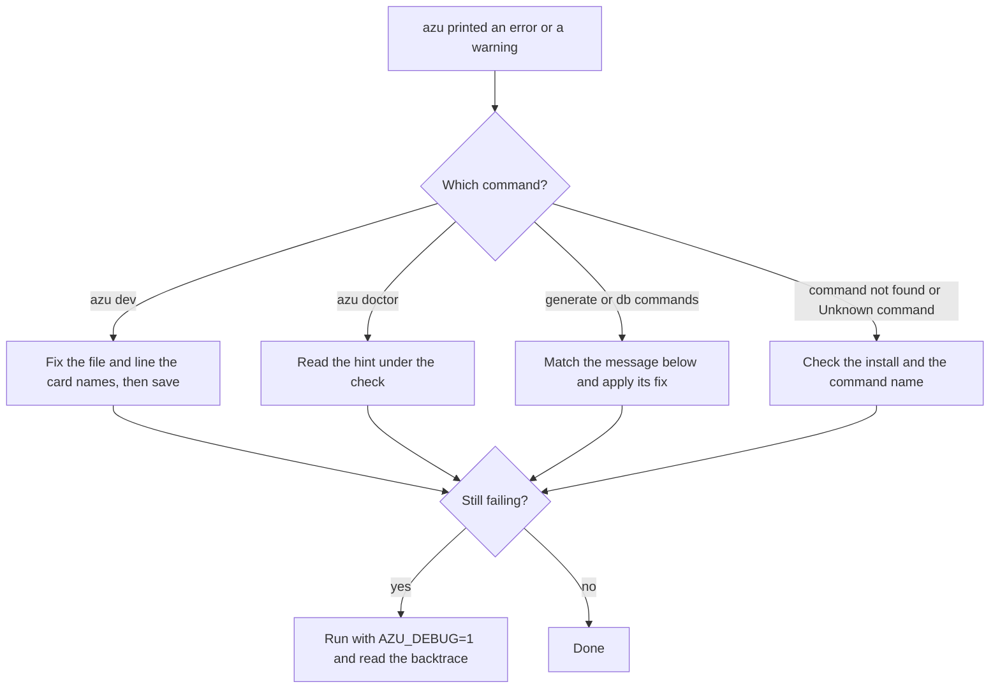

# Troubleshooting

Most azu errors name what to fix: a file and line, a variable, or a hint under the failing check. Start with `azu doctor`, then find the message below and apply its fix. When `azu dev` cannot build, the app you were running keeps running and the card shows the compiler's message.

## Overview & visual demo

<figure><figcaption><p>A failed build: the file and line, the compiler's message, and the keys. The app keeps serving until a build passes.</p></figcaption></figure>



## Quickstart & command syntax

Three commands cover most cases:

```bash
azu doctor                   # toolchain, dependencies, database, .env, secrets and port
azu doctor --json            # the same checks as JSON, for scripts and CI
AZU_DEBUG=1 azu db:status    # debug logging and full backtraces for any command
```

| Command       | Exit codes                                                                 | Where its messages appear                                       |
| ------------- | -------------------------------------------------------------------------- | --------------------------------------------------------------- |
| `azu doctor`  | `0` no check failed (warnings allowed), `1` a check failed, `2` bad usage  | One line per check, with a `hint:` line under each problem      |
| `azu dev`     | `0` stopped by Ctrl-C or SIGTERM, `1` not an Azu project, `2` bad usage    | The dashboard, or plain lines with `--ui plain`                 |
| `azu console` | `2` when this Crystal has no interpreter                                   | The reason, and what to install                                 |

| Setting       | Effect                                                                       |
| ------------- | ---------------------------------------------------------------------------- |
| `AZU_DEBUG`   | Any value turns on debug logging and adds the backtrace to errors            |
| `AZU_UI`      | `rich`, `plain` or `json`, the same as `--ui`                                |
| `NO_COLOR`    | Turns color off                                                              |
| `FORCE_COLOR` | Keeps color when stdout is a pipe                                            |
| `CI`          | Plain lines instead of the rich card                                         |

## Realistic output

`azu doctor` on a project with one warning. The text is the plain form that `--ui plain` and pipes print:


```text
ok    crystal        Crystal 1.22.1 (the project needs 1.22.1 or newer)
ok    shards         Shards 0.19.1
ok    dependencies   installed and in sync with shard.lock
warn  database       SQLite file ./db/blog_development.db does not exist yet
                     hint: run 'azu db:setup'
...

8 ok, 1 warnings, 0 failures
```


*A warning prints its hint on the next line. The exit code stays 0.*

The card `azu dev` draws when a build fails, from the screenshot above:


```text
Build failed · the app keeps running the previous build (pid 1195)

✖ src/demo_app.cr:79:6

   79 | puts undefined_thing_xyz
              ^------------------
Error: undefined local variable or method 'undefined_thing_xyz' for top-level

[Esc] Back to the dashboard   [r] Retry build   [q] Quit
```


*Fix the line the card names and save. The card closes on the next good build.*

### Install and the command line

<details>

<summary>command not found: azu</summary>

Cause: the shell cannot find the binary. This message comes from your shell, not from azu.

Fix: from the repository, build the CLI and put it on your `PATH`:

```bash
make build
make install    # copies bin/azu to /usr/local/bin/azu, may need sudo
```

`make link` symlinks `bin/azu` into `/usr/local/bin` instead. Confirm with `which azu` and `azu version`. More in [installation](../getting-started/installation.md).

</details>

<details>

<summary>Unknown command: NAME</summary>

Cause: a typo, or a command azu does not have. azu prints `Run 'azu help' to see available commands` under it and exits with `1`.

Fix: run `azu help` and copy the name from there. Some commands have short aliases, such as `g` for `generate`, `s` for `serve` and `t` for `test`.

</details>

<details>

<summary>Colors, boxes or a card in CI logs</summary>

Cause: a card needs a terminal with color. In CI (`CI` set), on a pipe, or with `NO_COLOR`, azu prints plain lines instead.

Fix: pass `--ui plain` to force lines, or `--ui json` where a command supports it. Set `NO_COLOR=1` to turn color off in a terminal.

</details>

### azu dev

<details>

<summary>shard.yml not found: run 'azu dev' in the root of an Azu project</summary>

Cause: you ran `azu dev` outside a project. It exits with `1`.

Fix: `cd` to the directory that holds `shard.yml`, then run `azu dev` again. More in [azu dev](../command-reference/azu-dev.md).

</details>

<details>

<summary>Build failed: the card names a file and line</summary>

Cause: the code does not compile. `azu dev` rebuilds when a file under `src/`, `config/`, `shard.yml` or `shard.lock` changes. A failed build never stops the running app.

Fix: fix the line the card shows and save. Keys on the card: `r` retries the build without a save, `Esc` returns to the dashboard, `q` quits.

</details>

<details>

<summary>A saved file did not rebuild or restart the app</summary>

Cause: `azu dev` acts only on these paths:

- `src/`, `config/`, `shard.yml`, `shard.lock`: build, then restart.
- `public/templates/`: no build. The templates hot reload.
- `.env` and `.env.<name>` in the project root: restart, no build. `.env.example` is ignored.
- Anything else is ignored, and so are editor swap and temporary files.

Changes are polled every 250 ms and acted on after 300 ms of quiet.

Fix: check that the file is in one of those paths. Press `r` in the dashboard to force a rebuild. On a very large tree, raise the polling interval with `azu dev --interval 1000`.

</details>

<details>

<summary>--port must be a number between 1 and 65535</summary>

Cause: `azu dev --port` got a value outside that range, or no number.

Fix: pass a valid port, for example `azu dev --port 4001`. `azu dev --debounce` and `--interval` reject values that are not positive milliseconds in the same way.

</details>

<details>

<summary>The port is still busy after azu dev was killed</summary>

Cause: `azu dev` stops the app on Ctrl-C or SIGTERM. If the command itself was killed with `kill -9`, nothing stops the app, and it keeps the port.

Fix: find the process that holds the port (`lsof -i :4000` on macOS and Linux), stop it, then start `azu dev` again. `azu doctor` reports the port as in use.

</details>

### azu doctor

<details>

<summary>Crystal X is older than the Y the project needs (shard.yml)</summary>

Cause: the installed Crystal is below the `crystal:` floor in `shard.yml`. X is your version and Y the floor.

Fix: install Crystal from [crystal-lang.org/install](https://crystal-lang.org/install/). Keep the floor quoted in `shard.yml`: `crystal: '>= 1.22.1'`. An unquoted `1.10` is read by YAML as the number `1.1`.

</details>

<details>

<summary>dependencies: the installed shards do not match shard.yml / shard.lock</summary>

Cause: `shards check` fails, so `lib/` is out of step with `shard.lock`. The warning `installed, but there is no shard.lock` means the lock file is missing.

Fix:

```bash
shards install
```

Commit `shard.lock` once it exists.

</details>

<details>

<summary>database: DATABASE_URL is not set</summary>

Cause: the project uses CQL and no `DATABASE_URL` reaches the process. Variables come from the shell and from the `.env` files.

Fix: set `DATABASE_URL` in `.env`, using the names in `.env.example` as the guide. More in [configuration](../advanced/configuration.md).

</details>

<details>

<summary>database: SQLite file ./db/NAME.db does not exist yet</summary>

Cause: the database file is created by the setup step, not by `azu doctor`.

Fix:

```bash
azu db:setup
```

</details>

<details>

<summary>database: cannot connect to HOST:PORT within 3s</summary>

Cause: the server does not accept TCP connections, or the host or port in `DATABASE_URL` is wrong. The check never tries credentials, and it never prints them.

Fix: start the database server, or correct `DATABASE_URL`. `azu db:status` tests the connection itself. A `DATABASE_URL` that does not start with `postgres://` or `mysql://` fails with the scheme as the problem. A unix-socket URL is a warning, because reachability is not checked for it.

</details>

<details>

<summary>env: not set: NAME, NAME</summary>

Cause: `.env.example` leaves these variables blank, and the process does not have them. Names only are printed.

Fix: set them in `.env`, in `.env.local`, or in the shell. With `CRYSTAL_ENV=production` this is a failure instead of a warning.

</details>

<details>

<summary>secrets: NAME look like a placeholder or are shorter than 32 characters</summary>

Cause: `CSRF_SECRET` or `SESSION_SECRET` is shorter than 32 characters or contains a placeholder word such as `changeme`. A `secret = "..."` literal in `src/` is reported the same way, with the file name.

Fix: generate a value and put it in `.env`:

```bash
openssl rand -hex 32
```

Read it in code with `Azu::Env.secret("NAME")`. Never copy a value into `src/`.

</details>

<details>

<summary>gitignore: .env is not git-ignored, or .env is tracked by git</summary>

Cause: `.env` holds secrets. Doctor fails when it is not in `.gitignore`, or when git already tracks it.

Fix: add `.env` to `.gitignore`. If it is tracked, run `git rm --cached .env`, then rotate the secrets it held, because they are in the history.

</details>

<details>

<summary>port: port 4000 is in use (the application may be running)</summary>

Cause: something listens on the port. This is a warning, because your app may be the one running.

Fix: stop that process, or set `PORT` to a free one (`azu dev --port 4001` also works).

</details>

### .env files

<details>

<summary>warning: ignoring NAME from a .env file: it is not a known application setting</summary>

Cause: azu applies a name from `.env` only when it is a known application setting or `.env.example` lists it. A commented-out entry in `.env.example` counts.

Fix: add the name, blank, to `.env.example`. A name that does not belong in the project is best left out of `.env`.

</details>

<details>

<summary>warning: ignoring NAME from a .env file: it changes how processes start</summary>

Cause: the name is on azu's denylist, such as `PATH`, `HOME`, `LD_*`, the compiler flags or proxy settings. azu never takes these from a file.

Fix: export the variable in your shell or your session profile.

</details>

<details>

<summary>I changed .env and nothing changed</summary>

Cause: a variable the shell already exports wins over every `.env` file. The files merge in this order, later ones winning: `.env`, then `.env.<CRYSTAL_ENV>`, then `.env.local`, and the process environment beats all of them.

Fix: check the shell with `env | grep NAME`, then `unset NAME` if it should come from `.env`. Do not leave a variable blank in `.env`: a blank value replaces a default once the file loads.

</details>

<details>

<summary>warning: DATABASE_URL is set in your environment and wins over .env.test</summary>

Cause: `azu test` loads `.env.test`, but a `DATABASE_URL` already in your shell wins, so the specs run against that database.

Fix: `unset DATABASE_URL`, then run `azu test` again.

</details>

### Database and generators

<details>

<summary>Database 'NAME' already exists. Use --force to recreate.</summary>

Cause: `azu db:create` found the database.

Fix: if you want the database dropped and recreated, run `azu db:create --force`. That destroys its data. To keep the data, leave it alone and run `azu db:migrate`. More in [database commands](../commands/database.md).

</details>

<details>

<summary>A migration named Create... exists already</summary>

Cause: a migration with that class name is already in `src/db/migrations/`. The generator refuses to define the same class twice.

Fix: choose another name. Do not delete a migration that has already run: check with `azu db:status` first.

</details>

<details>

<summary>A generator would overwrite my files</summary>

Cause: `azu generate` writes over existing files only with `--force` (its help text: "Overwrite existing files").

Fix: preview first with `azu generate ... --dry-run`. On a terminal, `azu generate` also shows the file list and diff before it writes. Run `azu undo` to revert the last generate that was written through the preview. `azu undo --dry-run` shows what it would do. Writes through a pipe or in CI skip the preview, so they keep no undo record. More in [generate](../commands/generate.md).

</details>

<details>

<summary>Nothing to undo: no azu generate wrote here through its preview</summary>

Cause: the last `azu generate` in this project did not run through the preview, or no generate ran here.

Fix: revert the files with git (`git status`, then `git checkout -- <file>` for changed files and delete the new ones yourself).

</details>

### Console

<details>

<summary>this Crystal has no interpreter (crystal i), so 'azu console' cannot open a REPL</summary>

Cause: some Crystal builds, including the official Docker images, ship without the interpreter. `azu console` exits with `2` rather than pretending.

Fix: install a Crystal that includes it, from [crystal-lang.org/install](https://crystal-lang.org/install/) or Homebrew, then check with `crystal i --help`. Until then, `azu routes` lists the routes. More in [console](../commands/console.md).

</details>

### Debugging

<details>

<summary>I need the backtrace</summary>

Cause: by default azu prints one line per error.

Fix: set `AZU_DEBUG` to any value for one run:

```bash
AZU_DEBUG=1 azu db:migrate
```

Debug logging appears, and errors include the backtrace. Clear the variable afterwards.

</details>

## Do's and don'ts


Run `azu doctor` before you report a bug, and paste its output. It prints variable names and never their values, and it never prints the password in a database URL.



**Pro tip:** `azu doctor --json` returns each check with its `status` and `hint`, so a script can act on one check without parsing text.



`azu doctor` exits `0` when it only warns. If CI must fail on a warning, read `summary.warn` from `--json` and fail the job yourself.



Don't `kill -9` `azu dev`: the app it started keeps running and holds the port. Don't commit `.env`, and don't copy a secret into `src/` to make a warning go away.

